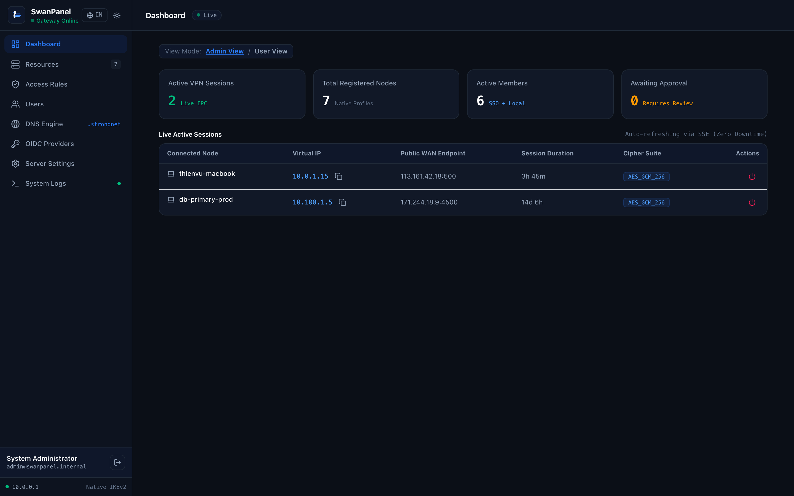
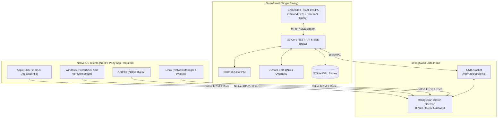

<div align="center">

<picture>
  <source media="(prefers-color-scheme: dark)" srcset="docs/assets/logo-dark.svg">
  <source media="(prefers-color-scheme: light)" srcset="docs/assets/logo-light.svg">
  
</picture>

# SwanPanel

**Modern, lightweight zero-trust web control plane for strongSwan IPsec VPN.**<br>
**100% native client provisioning. Zero third-party apps to install.**

[](https://github.com/thienvu18/swan-panel/stargazers)
[](https://github.com/thienvu18/swan-panel/releases)
[](https://github.com/thienvu18/swan-panel/actions/workflows/ci.yml)
[](https://github.com/thienvu18/swan-panel/discussions)
[](https://golang.org)
[](https://github.com/strongswan/strongswan)
[](LICENSE)

[Website & Docs](https://thienvu18.github.io/swan-panel/) • [English](README.md) • [Tiếng Việt](README.vi.md) • [Discussions](https://github.com/thienvu18/swan-panel/discussions) • [Wiki](https://github.com/thienvu18/swan-panel/wiki)

<br>

<p align="center">
  
</p>

</div>

---

## The Problem & The SwanPanel Solution

Whether you are hosting a private homelab or managing corporate remote access for hundreds of engineers, traditional VPN solutions force painful tradeoffs:

* **The Third-Party App Nightmare:**
  Solutions like OpenVPN, WireGuard, and Tailscale require every single user to install, update, and maintain proprietary background client apps on their laptops and smartphones. These background applications drain batteries, consume system RAM, and frequently conflict with operating system network settings.
  * **SwanPanel Solution:** Uses native **IKEv2/IPsec**, which is already built directly into the kernel of Apple iOS, macOS, Windows 10/11, Linux, and Android. Your users connect directly via their native System Settings. Zero third-party apps required.

* **The Fragility of strongSwan CLI & SSH:**
  strongSwan provides unmatched kernel-level IPsec throughput, but administrating it requires SSH terminal access, complex manual editing of static text files (`swanctl.conf`, `ipsec.conf`), and tedious OpenSSL command-line certificate generation. A single typo can crash the daemon, and reloading config files risks dropping active tunnels.
  * **SwanPanel Solution:** A modern, zero-SSH web interface. Communicates directly with strongSwan via its official UNIX domain socket (`/var/run/charon.vici`) to reload connections dynamically in RAM with zero downtime.

* **Bloated Multi-Container Overhead:**
  Many modern VPN management web panels demand complex Docker Compose deployments requiring separate Node.js runtimes, Python daemons, PostgreSQL databases, and Redis caches, consuming hundreds of megabytes of RAM before the first user even connects.
  * **SwanPanel Solution:** Compiled into a **single self-contained binary**. Pure Go backend, embedded React 19 SPA, embedded SQLite in high-performance WAL mode, internal PKI, and built-in Split-DNS. Runs on less than 30MB of idle RAM on a $5 VPS or a Raspberry Pi.

---

## 100% Native Client Support Matrix

SwanPanel provisions native OS connection profiles with embedded cryptographic credentials in one click:

| Client Platform | Protocol | Third-Party App Required? | Provisioning Method |
| :--- | :--- | :--- | :--- |
| **Apple iOS** | Native IKEv2 / IPsec | **NO (0 Apps)** | 1-click signed `.mobileconfig` profile with embedded PKCS#12 cert & CA trust chain |
| **Apple macOS** | Native IKEv2 / IPsec | **NO (0 Apps)** | 1-click signed `.mobileconfig` profile installed directly into System Settings |
| **Windows 10 / 11** | Native IKEv2 / IPsec | **NO (0 Apps)** | Automated idempotent PowerShell script (`Add-VpnConnection`) with split-tunnel routing |
| **Linux Desktop** | Native IKEv2 / IPsec | **NO (0 Apps)** | Auto-generated NetworkManager `.nmconnection` profile or standard `swanctl.conf` |
| **Android** | Native IKEv2 / IPsec | **NO (0 Apps)** | Standard native IKEv2 RSA certificate & MSCHAPv2 profile parameters |

---

## Competitive Comparison

How SwanPanel compares to other self-hosted and mesh VPN solutions:

| Feature | SwanPanel | WireGuard (wg-easy) | Tailscale / Headscale | Raw strongSwan (CLI) |
| :--- | :--- | :--- | :--- | :--- |
| **Client Software** | **100% Native OS Stack** | WireGuard App Required | Tailscale App Required | 100% Native OS Stack |
| **Control Plane Web UI** | Modern React 19 (Embedded) | Basic Web UI | SaaS Dashboard / Headscale-UI | None (Terminal Only) |
| **Deployment Model** | **Single Self-Contained Binary** | Docker Container | SaaS Cloud / Multi-Service | Host Package Daemon |
| **Idle Memory Footprint**| **< 30 MB RAM** | ~50 - 100 MB RAM | High (if self-hosting Headscale)| Very Low |
| **PKI & Certificate Engine**| Automated Internal CA & .p12 | WireGuard Keypairs | Managed by SaaS IdP | Manual OpenSSL / CFSSL |
| **Non-Disruptive Reloads** | **In-Memory RAM Hot-Reload** | Interface Toggle | Cloud-managed | Daemon Restart Drops Tunnels |
| **Built-in Split-DNS Engine** | Included with Custom Overrides | Requires External DNS | MagicDNS Included | Requires BIND / Unbound |
| **Data & Key Sovereignty** | **100% Self-Hosted & Sovereign**| 100% Self-Hosted | Vendor Cloud Dependent | 100% Self-Hosted |
| **Licensing** | **Open Source (AGPL-3.0)** | Open Source (MIT) | Per-user SaaS / BSD | Open Source (GPL) |

---

## Key Capabilities

### 1. Zero-SSH strongSwan Control via VICI IPC
* **Live In-Memory Hot-Reloads:** Communicates directly with the `charon` daemon via strongSwan's UNIX socket (`/var/run/charon.vici`) using the `govici` protocol. Reloads connections dynamically in RAM without interrupting existing active tunnels.
* **Real-Time Session Teardown:** Terminate active sessions immediately, enforce re-authentication lifetimes, and monitor real-time tunnel status.
* **Data Plane Optimization:** Configure MOBIKE client roaming, force UDP NAT-Traversal encapsulation, dead peer detection (DPD) keepalives, fragmentation, and TCP MSS clamping.

### 2. Automated Internal PKI (X.509)
* **Zero-Touch Certificate Authority:** Automatically initializes and manages the root CA, server certificates, and individual client certificates.
* **PKCS#12 Bundling:** Generates password-protected PKCS#12 (`.p12`) bundles on the fly for native client import without requiring command-line OpenSSL or CFSSL utilities.

### 3. Configurable Split-DNS & Custom Domain Overrides
* **Built-in High-Concurrency DNS Server:** Embedded DNS engine (`github.com/miekg/dns`). Suffixes are fully customizable (e.g. `.internal`, `.corp`, `.home`, `.vpn`) and resolve automatically to assigned virtual device IPs.
* **Instant Custom Overrides:** Manually define custom DNS records (e.g. pointing `nas.home.internal` or `gitlab.corp.internal` to specific internal endpoints) with instant propagation across all connected VPN clients.
* **Upstream Forwarding:** Forwards non-internal queries to configurable upstream public or corporate resolvers (1.1.1.1, 8.8.8.8).

### 4. Live Operations & Real-Time Dashboard
* **Server-Sent Events (SSE):** Event broker pushes active session updates, byte transfer counters, and connection states to the browser without client-side polling loops.
* **Centralized Log Streaming:** Inspect and filter strongSwan daemon events by user, device, and log severity levels.

### 5. Zero-Trust Access Policies & Identity Directory
* **Multi-IdP SSO & Local Directory:** Authenticate admins and users via OIDC providers (Google, Microsoft Azure AD, Okta, Keycloak) or local credentials.
* **Granular Access Control:** Define user groups and isolate access by CIDR subnet destinations (e.g. Production VPC, Staging, Internal Subnets).

### 6. Single-Binary, Zero-Dependency Architecture
* **Single Executable:** Go backend, embedded SQLite database (in high-performance WAL mode), embedded React 19 SPA, PKI, and DNS engine compile into one self-contained binary.
* **No External Database Required:** Zero external dependencies on PostgreSQL, MySQL, Redis, or heavy orchestration frameworks.

---

## Architecture



---

## Quick Start

### Option 1: 1-Line Automated Production Install (Recommended)
Run the automated installation script on any clean Ubuntu, Debian, Rocky Linux, AlmaLinux, or Fedora server:
```bash
curl -fsSL https://raw.githubusercontent.com/thienvu18/swan-panel/main/install.sh | sudo bash
```
The installer automatically detects your operating system, configures kernel packet forwarding, prepares strongSwan, installs the SwanPanel single binary, and enables the systemd service.

### Option 2: Docker Compose Deployment (Homelab & Containers)
1. Clone the repository:
   ```bash
   git clone https://github.com/thienvu18/swan-panel.git
   cd swan-panel
   ```
2. Start the service with Docker Compose:
   ```bash
   docker compose up -d
   ```
3. Inspect container logs:
   ```bash
   docker compose logs -f
   ```

*(The container bundles strongSwan, iptables, and Split-DNS, running with `cap_add: [NET_ADMIN, NET_RAW]` and mounting `/var/run/charon.vici`)*.

### Option 3: Build from Source
```bash
git clone https://github.com/thienvu18/swan-panel.git
cd swan-panel

# Build embedded React 19 UI and single Go binary
cd ui && npm install && npm run build && cd ..
go build -o swan-panel ./cmd/server

# Run SwanPanel
./swan-panel
```
Access the web control plane at `http://localhost:8080`.

### Default Admin Credentials
* **Email:** `admin@swanpanel.internal`
* **Password:** `admin123456`

*(Important: Change the default password immediately upon initial login).*

---

## Production Deployment & Security Standards

### Native Systemd Daemon Setup
For bare-metal or virtual machine deployments where strongSwan runs directly on the host:
```bash
sudo install -m 755 swan-panel /usr/local/bin/swan-panel
sudo mkdir -p /etc/swan-panel /var/lib/swan-panel
sudo cp deploy/swan-panel.env.example /etc/swan-panel/swan-panel.env
sudo chmod 600 /etc/swan-panel/swan-panel.env
sudo cp deploy/systemd/swan-panel.service /etc/systemd/system/swan-panel.service

sudo systemctl daemon-reload
sudo systemctl enable --now strongswan-starter || sudo systemctl enable --now strongswan
sudo systemctl enable --now swan-panel
```

### Configuration Reference

Configure SwanPanel via environment variables or an `/etc/swan-panel/swan-panel.env` file:

| Variable | Default | Description |
| :--- | :--- | :--- |
| `PORT` | `8080` | HTTP port for the web control plane and REST API |
| `DB_PATH` | `swanpanel.db` | SQLite database file location |
| `JWT_SECRET` | *(Auto-generated)* | Cryptographic key for signing JWT session tokens (**change in production**) |
| `LOG_LEVEL` | `info` | Logging verbosity: `debug`, `info`, `warn`, `error` |
| `VICI_SOCKET` | `/var/run/charon.vici` | Path to strongSwan charon UNIX domain socket |
| `ENABLE_DNS` | `true` | Enable built-in Split-DNS engine |
| `DNS_PORT` | `5353` | Port for the DNS server (`53` for production root binding) |
| `APP_ENV` | `development` | Environment mode (`development` or `production`) |

### Strict Engineering & Security Invariants
* **Zero SQL Injection:** 100% parameterized queries via GORM ORM; dynamic string concatenation in queries is strictly prohibited.
* **OWASP Hardened:** Standard HTTP security headers configured out of the box (HSTS, CSP, `X-Frame-Options: DENY`, `X-Content-Type-Options: nosniff`).
* **Timing-Safe Cryptography:** Authentication tokens, API keys, and hashes are compared in constant time (`crypto/subtle.ConstantTimeCompare`).
* **Rate Limiting:** In-memory token-bucket rate limiters on all public authentication routes.

---

## Roadmap

SwanPanel is actively maintained. Here is our prioritized engineering roadmap:

* **Current Stable Release (v0.0.2):**
  * Single-binary delivery with embedded React 19 UI and pure Go SQLite WAL.
  * 1-click native client provisioning for Apple iOS/macOS, Windows, Linux, and Android.
  * strongSwan VICI IPC hot-reload without tunnel disruption.
  * Automated internal PKI and PKCS#12 bundle export.
  * Built-in Split-DNS server with custom domain overrides.
  * Real-time SSE dashboard and live system logging.

* **Upcoming Milestones:**
  * **High Availability (HA) & Clustering:** Active-Passive failover and state synchronization across multiple SwanPanel gateways for hardware redundancy.
  * **Multi-Factor Authentication (MFA / TOTP):** Two-factor authentication support for Web Admin login and client profile self-service enrollment.
  * **Immutable Audit Trail & SIEM Integration:**
    * Comprehensive `audit_logs` table tracking administrator actions (who, what, when, source IP, e.g. User 'admin' revoked device 'laptop-dev').
    * Instant webhook alerts to Slack, Telegram, and Microsoft Teams for anomalous events (repeated failed logins, gateway offline, cert revocation).
    * Standard Syslog export compliant with RFC 5424 for external SIEM ingestion (Splunk, Elastic, Datadog).
  * **1-Click Encrypted Backup & Disaster Recovery:**
    * One-click backup in Server Settings: bundles SQLite database and Root CA private keys into an AES-256-GCM encrypted `.tar.enc` archive with a user-supplied passphrase.
    * In-place 1-click restore mechanism to recover state immediately after server migrations or disk failures.

---

## Community & Contributing

SwanPanel is a community-driven open-source project. We welcome contributions from developers, sysadmins, and homelab enthusiasts:

* **Join the Community:** Ask questions, share your homelab architecture, or propose ideas in [GitHub Discussions](https://github.com/thienvu18/swan-panel/discussions).
* **Report Issues & Bugs:** Open an issue on GitHub with reproduction steps and log outputs.
* **Submit Pull Requests:** Review existing issues, follow the conventions in [AGENTS.md](AGENTS.md), and verify that all tests pass (`go test -v ./...`).
* **Contribute Translations (i18n):**
  1. Duplicate `ui/src/locales/en.json` to `ui/src/locales/<language-code>.json`.
  2. Translate values while preserving JSON structure and keys.
  3. Register the new locale in `ui/src/i18n.ts` and submit a PR!

### Support the Project
If SwanPanel simplifies your self-hosted setup or remote access infrastructure, please consider giving us a **Star on GitHub**. It helps the project reach more system administrators and developers!

[](https://star-history.com/#thienvu18/swan-panel&Date)

---

## Authors & Contributors

### Creator & Lead Maintainer
* **Thái Thiên Vũ** ([@thienvu18](https://github.com/thienvu18))

<a href="https://github.com/thienvu18">
  
</a>

### Contributors
We thank all contributors who help improve SwanPanel!

<a href="https://github.com/thienvu18/swan-panel/graphs/contributors">
  
</a>

---

## Documentation Links

* [Administrator User Guide](docs/ADMIN_USER_GUIDE.md) — Comprehensive guide for deploying, managing, and securing SwanPanel.
* [End-User Client Guide](docs/END_USER_GUIDE.md) — Step-by-step native VPN connection guide for macOS, iOS, Windows, Linux, and Android.
* [Interactive Web Documentation](https://thienvu18.github.io/swan-panel/guide.html) — Live GitHub Pages user guide and operations manual.
* [System Architecture & DB Specs](ARCHITECTURE.md) — GORM relational schema, REST endpoints, and VICI workflow.
* [UI/UX Design Specification](DESIGN.md) — Google Labs `design.md` compliance, design tokens, and components.
* [AI Agent Guidelines](AGENTS.md) — Coding conventions, security mandates, and build instructions.

---

## License

SwanPanel is licensed under the **GNU Affero General Public License v3.0 (AGPL-3.0)**.

* **Free & Self-Hosted Use:** You are completely free to run SwanPanel for personal homelabs, non-profit organizations, and internal corporate infrastructure to manage private VPN networks.
* **Strong Copyleft:** Any modifications made to SwanPanel that are served over a network must be open-sourced under the same AGPL-3.0 license terms.
* **Anti-SaaS Clause:** Third parties and commercial cloud providers may not offer SwanPanel as a hosted multi-tenant SaaS product to customers without releasing their entire management stack under AGPL-3.0 or obtaining an explicit commercial license.
