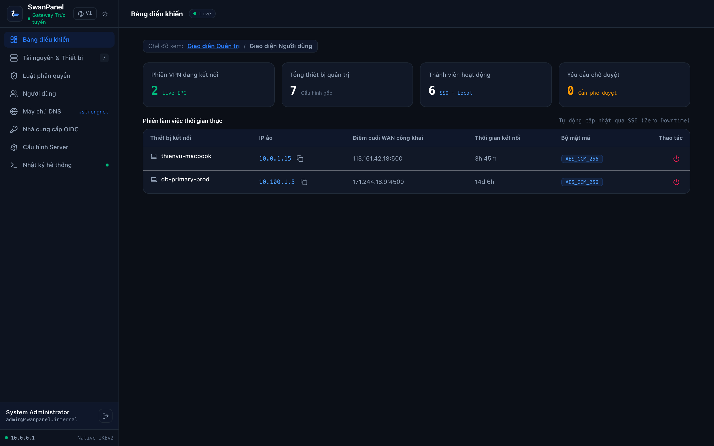
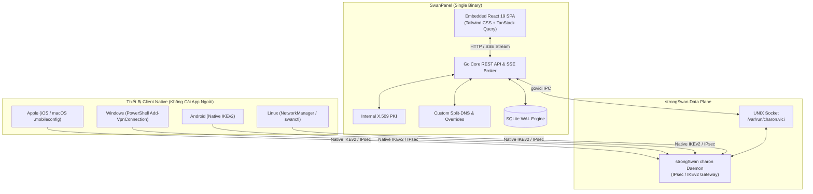

<div align="center">

<picture>
  <source media="(prefers-color-scheme: dark)" srcset="docs/assets/logo-dark.svg">
  <source media="(prefers-color-scheme: light)" srcset="docs/assets/logo-light.svg">
  
</picture>

# SwanPanel

**Bảng điều khiển Web hiện đại, gọn nhẹ cho strongSwan IPsec VPN.**<br>
**Cấu hình 100% native client trên hệ điều hành. Không cần cài bất kỳ ứng dụng bên thứ ba nào.**

[](https://github.com/thienvu18/swan-panel/stargazers)
[](https://github.com/thienvu18/swan-panel/releases)
[](https://github.com/thienvu18/swan-panel/actions/workflows/ci.yml)
[](https://github.com/thienvu18/swan-panel/discussions)
[](https://golang.org)
[](https://github.com/strongswan/strongswan)
[](LICENSE)

[Website & Tài liệu](https://thienvu18.github.io/swan-panel/) • [English](README.md) • [Tiếng Việt](README.vi.md) • [Thảo luận](https://github.com/thienvu18/swan-panel/discussions) • [Wiki](https://github.com/thienvu18/swan-panel/wiki)

<br>

<p align="center">
  
</p>

</div>

---

## Vấn đề Cốt lõi & Giải pháp của SwanPanel

Dù bạn đang quản lý một cụm Homelab cá nhân hay vận hành hạ tầng VPN truy cập từ xa cho hàng trăm nhân viên trong doanh nghiệp, các giải pháp VPN truyền thống luôn bắt bạn phải đánh đổi:

* **Nỗi ám ảnh về Ứng dụng bên thứ ba:**
  Các giải pháp như OpenVPN, WireGuard hay Tailscale đều bắt buộc mọi người dùng cuối phải cài đặt, cấp quyền hệ thống và cập nhật liên tục ứng dụng client của họ trên từng máy tính và điện thoại. Các ứng dụng chạy nền này làm hao pin, chiếm dụng RAM và thường xuyên xung đột với cấu hình mạng của hệ điều hành.
  * **Giải pháp của SwanPanel:** Sử dụng chuẩn **IKEv2/IPsec đã được tích hợp sẵn trong nhân (Kernel) của iOS, macOS, Windows 10/11, Linux và Android**. Người dùng kết nối trực tiếp trong phần Cài đặt mạng của hệ điều hành. Hoàn toàn không cần cài bất kỳ ứng dụng ngoài nào.

* **Sự mong manh của việc quản trị strongSwan qua CLI và SSH:**
  strongSwan mang lại tốc độ mã hóa phần cứng cực cao, nhưng việc quản trị qua terminal đòi hỏi phải SSH vào máy chủ, tự gõ lệnh OpenSSL để sinh chứng chỉ X.509 và chỉnh sửa thủ công các file cấu hình phức tạp (`swanctl.conf`, `ipsec.conf`). Chỉ một lỗi cú pháp nhỏ cũng có thể khiến tiến trình bị dừng, và mỗi lần nạp lại cấu hình đều có nguy cơ làm rớt toàn bộ các kết nối đang hoạt động.
  * **Giải pháp của SwanPanel:** Bảng điều khiển Web hiện đại, không cần mở SSH. Giao tiếp trực tiếp với tiến trình strongSwan qua UNIX domain socket chính thức (`/var/run/charon.vici`) để nạp lại cấu hình trên RAM mà không làm ngắt kết nối của người dùng (zero-downtime hot-reload).

* **Kiến trúc cồng kềnh, ngốn tài nguyên:**
  Nhiều hệ thống quản trị VPN nguồn mở hiện nay yêu cầu các cụm Docker Compose phức tạp gồm nhiều container riêng biệt: Node.js, Python, cơ sở dữ liệu PostgreSQL, Redis, Nginx... ngốn hàng trăm megabyte RAM trước khi có người dùng đầu tiên kết nối.
  * **Giải pháp của SwanPanel:** Được biên dịch thành **một file thực thi duy nhất (Single Binary)**. Go backend, giao diện React 19 SPA nhúng sẵn, cơ sở dữ liệu SQLite thuần Go (chế độ WAL hiệu năng cao), PKI tự động và máy chủ Split-DNS tích hợp. Chiếm chưa tới 30MB RAM ở trạng thái nghỉ, hoạt động mượt mà trên VPS 5$/tháng hoặc Raspberry Pi.

---

## Ma trận Hỗ trợ Thiết bị Native 100%

SwanPanel xuất cấu hình kết nối chuẩn hệ điều hành kèm chứng chỉ mã hóa chỉ với một cú click chuột:

| Nền tảng Client | Giao thức | Cần cài App ngoài? | Phương thức Cài đặt & Kết nối |
| :--- | :--- | :--- | :--- |
| **Apple iOS** | Native IKEv2 / IPsec | **KHÔNG (0 App)** | 1-Click tải profile `.mobileconfig` (nhúng sẵn chứng chỉ PKCS#12 và CA trust chain) |
| **Apple macOS** | Native IKEv2 / IPsec | **KHÔNG (0 App)** | 1-Click tải profile `.mobileconfig` cài trực tiếp vào Cài đặt hệ thống (System Settings) |
| **Windows 10 / 11** | Native IKEv2 / IPsec | **KHÔNG (0 App)** | Chạy script PowerShell tự động (`Add-VpnConnection`) tích hợp sẵn định tuyến split-tunnel |
| **Linux Desktop** | Native IKEv2 / IPsec | **KHÔNG (0 App)** | File cấu hình NetworkManager (`.nmconnection`) hoặc mẫu chuẩn `swanctl.conf` |
| **Android** | Native IKEv2 / IPsec | **KHÔNG (0 App)** | Cấu hình thông số IKEv2 RSA Certificate & MSCHAPv2 chuẩn native của hệ điều hành |

---

## Bảng So sánh Đối đầu Toàn diện

So sánh SwanPanel với các giải pháp VPN tự host và mesh VPN phổ biến:

| Tính năng | SwanPanel | WireGuard (wg-easy) | Tailscale / Headscale | strongSwan thuần (CLI) |
| :--- | :--- | :--- | :--- | :--- |
| **Cài đặt App bên thứ ba** | **100% Native OS Stack** | Bắt buộc cài app WireGuard | Bắt buộc cài app Tailscale | 100% Native OS Stack |
| **Giao diện Web trực quan** | React 19 nhúng sẵn hiện đại | Giao diện Web đơn giản | Giao diện Cloud / Headscale-UI | Không có (chỉ có terminal) |
| **Kiến trúc triển khai** | **Một file thực thi duy nhất**| Docker Container | Cụm SaaS Cloud / Đa dịch vụ | Cài gói daemon trên máy chủ |
| **Bộ nhớ RAM trạng thái nghỉ**| **< 30 MB RAM** | ~50 - 100 MB RAM | Cao (nếu tự host Headscale) | Rất thấp (chỉ daemon) |
| **Quản lý Chứng chỉ PKI** | Tự động hóa CA & xuất .p12 | Cặp khóa WireGuard | Quản lý qua tài khoản SSO | Phải gõ OpenSSL thủ công |
| **Nạp cấu hình không rớt mạng**| **Hot-reload trực tiếp trên RAM**| Khởi động lại interface | Đồng bộ qua Cloud | Khởi động lại dễ rớt tunnel |
| **Tích hợp Split-DNS nội bộ** | Có sẵn & ghi đè DNS tức thì | Phải cấu hình máy chủ ngoài | Có sẵn (MagicDNS) | Phải tự dựng BIND / Unbound |
| **Tự chủ Dữ liệu & Khóa** | **100% Self-Hosted & Tự chủ** | 100% Self-Hosted | Phụ thuộc dịch vụ bên thứ ba | 100% Self-Hosted |
| **Giấy phép Bản quyền** | **Mã nguồn mở (AGPL-3.0)** | Mã nguồn mở (MIT) | Trả phí theo user (SaaS) | Mã nguồn mở (GPL) |

---

## Danh sách Tính năng Nổi bật

### 1. Điều khiển strongSwan Động qua VICI IPC (Zero-SSH)
* **Hot-Reload trực tiếp trên RAM:** Giao tiếp trực tiếp với tiến trình `charon` qua UNIX domain socket chính thức (`/var/run/charon.vici`) bằng giao thức `govici`. Nạp lại cấu hình trên bộ nhớ RAM mà không làm ngắt các kết nối đang hoạt động.
* **Quản trị Phiên Thời gian Thực:** Ngắt kết nối tức thì (`terminate`), ép xác thực lại định kỳ và theo dõi trạng thái đường truyền trực tiếp từ giao diện web.
* **Tối ưu hóa Tham số Data Plane:** Bật/tắt chuyển vùng mạng (MOBIKE), ép đóng gói UDP NAT-Traversal, điều chỉnh tần suất DPD keepalive, phân mảnh gói tin và kẹp TCP MSS clamping.

### 2. Tự động hóa Internal PKI (X.509)
* **Khởi tạo CA Tự động:** Tự động tạo và quản lý Certificate Authority (CA) gốc, chứng chỉ máy chủ gateway và chứng chỉ riêng cho từng thiết bị/người dùng.
* **Đóng gói PKCS#12 Tự động:** Xuất gói chứng chỉ bảo vệ bằng mật khẩu (.p12) tải về dùng ngay, không cần gõ lệnh OpenSSL hay CFSSL qua terminal.

### 3. Split-DNS Tùy biến Linh hoạt & Ghi đè Tên miền (DNS Overrides)
* **MagicDNS Tùy biến Đuôi Tên miền:** Tích hợp máy chủ DNS nội bộ hiệu năng cao (`github.com/miekg/dns`). Đuôi tên miền nội bộ hoàn toàn tùy chỉnh theo ý muốn (ví dụ: `.internal`, `.corp`, `.home`, `.vpn`), tự động phân giải về IP ảo của từng thiết bị.
* **Tính năng Ghi đè DNS (DNS Overrides):** Cho phép tự do định nghĩa các bản ghi DNS tùy chỉnh (ví dụ: trỏ `nas.home.internal` hoặc `gitlab.corp.internal` thẳng tới IP đích chỉ định), có hiệu lực tức thì cho toàn bộ máy client trong mạng VPN.
* **Chuyển tiếp Truy vấn Ngoài (Upstream Forwarding):** Tự động chuyển tiếp các truy vấn internet đến DNS chỉ định của doanh nghiệp hoặc DNS công cộng (1.1.1.1, 8.8.8.8).

### 4. Giám sát & Bảng Điều khiển Trực tiếp (Real-Time Live Dashboard)
* **Server-Sent Events (SSE):** Luồng sự kiện `/api/realtime/stream` đẩy dữ liệu phiên kết nối, lưu lượng băng thông và trạng thái gateway trực tiếp lên màn hình mà không cần chạy vòng lặp polling hay nhấn refresh.
* **Luồng Nhật ký Hệ thống (Live Logs):** Xem và lọc log chi tiết của strongSwan theo từng người dùng, thiết bị và cấp độ nghiêm trọng.

### 5. Phân quyền Truy cập Zero-Trust & Thư mục Danh tính
* **Đa nhà cung cấp OIDC SSO & Local Directory:** Đăng nhập qua các IdP chuẩn OIDC (Google, Microsoft Azure AD, Okta, Keycloak) hoặc tài khoản quản trị nội bộ.
* **Luật Truy cập Phân cấp:** Thiết lập nhóm người dùng (DevOps, Sales) và phân bổ quyền truy cập theo dải mạng CIDR (Production VPC, Staging, Internal Subnets).

### 6. Kiến trúc Single-Binary Gọn nhẹ, Không Phụ thuộc
* **Một Tệp Thực thi Duy nhất:** Go backend, cơ sở dữ liệu SQLite thuần Go (chế độ WAL hiệu năng cao), giao diện React 19 SPA nhúng sẵn, PKI và máy chủ DNS được biên dịch thành 1 file nhị phân duy nhất.
* **Không Cần Cài Database Ngoài:** Hoạt động độc lập không phụ thuộc vào PostgreSQL, MySQL, Redis hay cụm container phức tạp.

---

## Sơ đồ Kiến trúc



---

## Khởi động Nhanh (Quick Start)

### Lựa chọn 1: Cài đặt Tự động 1 Dòng lệnh (Khuyên dùng)
Chạy script cài đặt tự động trên các máy chủ Ubuntu, Debian, Rocky Linux, AlmaLinux hoặc Fedora:
```bash
curl -fsSL https://raw.githubusercontent.com/thienvu18/swan-panel/main/install.sh | sudo bash
```
Script sẽ tự động nhận diện hệ điều hành, tối ưu hóa kernel forwarding, cài đặt strongSwan, nạp file thực thi SwanPanel và kích hoạt service systemd.

### Lựa chọn 2: Triển khai với Docker Compose (Cho Homelab & Container)
1. Clone mã nguồn về máy:
   ```bash
   git clone https://github.com/thienvu18/swan-panel.git
   cd swan-panel
   ```
2. Khởi chạy bằng Docker Compose:
   ```bash
   docker compose up -d
   ```
3. Xem nhật ký hoạt động của container:
   ```bash
   docker compose logs -f
   ```

*(Container đóng gói sẵn strongSwan, iptables và Split-DNS, chạy với quyền `cap_add: [NET_ADMIN, NET_RAW]` và gắn kết `/var/run/charon.vici`)*.

### Lựa chọn 3: Tự Biên dịch từ Mã nguồn (Build from Source)
```bash
git clone https://github.com/thienvu18/swan-panel.git
cd swan-panel

# Biên dịch giao diện React 19 và file thực thi Go
cd ui && npm install && npm run build && cd ..
go build -o swan-panel ./cmd/server

# Chạy SwanPanel
./swan-panel
```
Truy cập bảng điều khiển web tại `http://localhost:8080`.

### Tài khoản Quản trị Mặc định
* **Email:** `admin@swanpanel.internal`
* **Mật khẩu:** `admin123456`

*(Lưu ý: Hãy đổi mật khẩu ngay sau lần đăng nhập đầu tiên để đảm bảo an toàn).*

---

## Triển khai Production & Tiêu chuẩn Bảo mật

### Cấu hình Systemd Daemon trên Máy chủ Vật lý
Dành cho máy chủ chạy trực tiếp strongSwan trên hệ điều hành host:
```bash
sudo install -m 755 swan-panel /usr/local/bin/swan-panel
sudo mkdir -p /etc/swan-panel /var/lib/swan-panel
sudo cp deploy/swan-panel.env.example /etc/swan-panel/swan-panel.env
sudo chmod 600 /etc/swan-panel/swan-panel.env
sudo cp deploy/systemd/swan-panel.service /etc/systemd/system/swan-panel.service

sudo systemctl daemon-reload
sudo systemctl enable --now strongswan-starter || sudo systemctl enable --now strongswan
sudo systemctl enable --now swan-panel
```

### Bảng Tham số Biến Môi trường

Cấu hình SwanPanel qua biến môi trường hoặc tệp `/etc/swan-panel/swan-panel.env`:

| Biến môi trường | Mặc định | Mô tả |
| :--- | :--- | :--- |
| `PORT` | `8080` | Cổng HTTP của giao diện Web và REST API |
| `DB_PATH` | `swanpanel.db` | Đường dẫn file cơ sở dữ liệu SQLite |
| `JWT_SECRET` | *(Ngẫu nhiên)* | Khóa ký số JWT phiên đăng nhập (**phải đổi khi lên production**) |
| `LOG_LEVEL` | `info` | Mức độ chi tiết của log: `debug`, `info`, `warn`, `error` |
| `VICI_SOCKET` | `/var/run/charon.vici` | Đường dẫn UNIX socket của strongSwan charon daemon |
| `ENABLE_DNS` | `true` | Kích hoạt máy chủ Split-DNS nội bộ |
| `DNS_PORT` | `5353` | Cổng của DNS server (`53` nếu chạy quyền root ở production) |
| `APP_ENV` | `development` | Chế độ môi trường (`development` hoặc `production`) |

### Tiêu chuẩn Kỹ thuật & Bảo mật Nghiêm ngặt
* **Không có SQL Injection:** 100% truy vấn tham số hóa qua GORM ORM; tuyệt đối nghiêm cấm nối chuỗi raw SQL.
* **Gia cố Tiêu chuẩn OWASP:** Cấu hình sẵn đầy đủ các header an toàn HTTP (HSTS, CSP, `X-Frame-Options: DENY`, `X-Content-Type-Options: nosniff`).
* **Mã hóa An toàn Trước Tấn công Thời gian (Timing Attacks):** Token, API key và mật khẩu băm được so sánh bằng thuật toán thời gian hằng số (`crypto/subtle.ConstantTimeCompare`).
* **Chống Tấn công Dò quét (Rate Limiting):** Tích hợp sẵn bộ giới hạn tần suất token-bucket trên các endpoint đăng nhập.

---

## Lộ trình Phát triển (Roadmap)

SwanPanel được duy trì và phát triển liên tục. Dưới đây là lộ trình kỹ thuật ưu tiên:

* **Phiên bản Hiện tại (v0.0.2 - Đã phát hành):**
  * Đóng gói single-binary với giao diện nhúng React 19 và SQLite thuần Go WAL.
  * Cấu hình 1-click cho Apple iOS/macOS, Windows, Linux và Android.
  * Điều khiển VICI IPC hot-reload RAM không gián đoạn kết nối.
  * Tự động hóa hoàn toàn CA nội bộ và xuất gói chứng chỉ PKCS#12.
  * Tích hợp máy chủ Split-DNS với tính năng ghi đè tên miền nội bộ.
  * Bảng điều khiển thời gian thực SSE và xem log hệ thống trực tiếp.

* **Các Mốc Phát triển Tiếp theo:**
  * **Cụm Sẵn Sàng Cao & Dự Phòng (High Availability & Clustering):** Cơ chế chuyển đổi dự phòng Active-Passive và đồng bộ trạng thái kết nối giữa nhiều gateway SwanPanel để chịu lỗi phần cứng.
  * **Xác thực Đa Yếu tố (Multi-Factor Authentication - MFA / TOTP):** Tích hợp xác thực 2 bước cho trang quản trị Web Admin và cổng đăng ký thiết bị tự phục vụ của người dùng.
  * **Nhật Ký Kiểm Toán Bất Biến & Tích Hợp SIEM (Audit Trail & SIEM Export):**
    * Đáp ứng tiêu chuẩn tuân thủ an toàn thông tin (ISO 27001, SOC 2).
    * Bảng `audit_logs` ghi nhận mọi hành vi quản trị (ai thực hiện, thao tác gì, lúc nào, từ IP nào, ví dụ: User 'admin' đã thu hồi thiết bị 'laptop-dev').
    * Tích hợp Webhook đẩy cảnh báo tức thì về Slack / Telegram / Microsoft Teams khi có sự kiện bất thường (đăng nhập thất bại liên tục, gateway offline, chứng chỉ bị thu hồi).
    * Hỗ trợ xuất nhật ký ra chuẩn Syslog (RFC 5424) để tích hợp vào các hệ thống SIEM doanh nghiệp (Splunk, Elastic, Datadog).
  * **Sao Lưu & Khôi Phục Dữ Liệu Mã Hóa 1-Click (Backup & Disaster Recovery):**
    * Bảo vệ dữ liệu cấu hình và khóa bí mật CA trước rủi ro hỏng ổ cứng hoặc nâng cấp máy chủ.
    * Nút sao lưu tại Server Settings: Đóng gói toàn bộ SQLite DB + Root CA vào một file `.tar.enc` mã hóa bằng AES-256-GCM với mật khẩu người dùng chỉ định.
    * Hỗ trợ nút khôi phục hệ thống (Restore) tức thì từ file sao lưu.

---

## Cộng đồng & Đóng góp (Community & Contributing)

SwanPanel là dự án mã nguồn mở vì cộng đồng. Chúng tôi luôn trân trọng mọi đóng góp từ các nhà phát triển, quản trị viên hệ thống và người đam mê homelab:

* **Tham gia Thảo luận:** Đặt câu hỏi, chia sẻ góc homelab hoặc đề xuất ý tưởng tại [GitHub Discussions](https://github.com/thienvu18/swan-panel/discussions).
* **Báo cáo Lỗi & Góp ý:** Mở Issue trên GitHub kèm mô tả chi tiết các bước tái hiện và trích xuất nhật ký lỗi.
* **Đóng góp Mã nguồn (Pull Request):** Kiểm tra danh sách Issue đang mở, tuân thủ hướng dẫn lập trình trong [AGENTS.md](AGENTS.md) và chạy kiểm thử thành công (`go test -v ./...`).
* **Đóng góp Bản dịch Ngôn ngữ (i18n):**
  1. Sao chép tệp `ui/src/locales/en.json` thành `ui/src/locales/<mã-ngôn-ngữ>.json`.
  2. Dịch các giá trị tương ứng và giữ nguyên cấu trúc key JSON.
  3. Đăng ký ngôn ngữ mới trong `ui/src/i18n.ts` và mở Pull Request!

### Ủng hộ Dự án
Nếu SwanPanel giúp ích cho bạn trong việc quản trị VPN gia đình hoặc hạ tầng mạng công ty, hãy **tặng dự án 1 Star trên GitHub**. Sự ủng hộ của bạn là động lực lớn để dự án ngày càng hoàn thiện!

[](https://star-history.com/#thienvu18/swan-panel&Date)

---

## Tác giả & Người Đóng góp

### Tác giả Sáng lập & Quản trị Dự án
* **Thái Thiên Vũ** ([@thienvu18](https://github.com/thienvu18))

<a href="https://github.com/thienvu18">
  
</a>

### Người Đóng góp
Xin chân thành cảm ơn tất cả các thành viên đã và đang đóng góp công sức phát triển SwanPanel!

<a href="https://github.com/thienvu18/swan-panel/graphs/contributors">
  
</a>

---

## Liên kết Tài liệu Kỹ thuật

* [Tài liệu Hướng dẫn Quản trị viên](docs/ADMIN_USER_GUIDE.md) — Hướng dẫn chuyên sâu về triển khai, cấu hình và bảo mật SwanPanel.
* [Tài liệu Hướng dẫn Người dùng Cuối](docs/END_USER_GUIDE.md) — Các bước kết nối VPN native trên macOS, iOS, Windows, Linux và Android.
* [Cổng Tài liệu Trực tuyến](https://thienvu18.github.io/swan-panel/guide.html) — Trang tài liệu tương tác trên GitHub Pages.
* [Kiến trúc Hệ thống & Cơ sở Dữ liệu](ARCHITECTURE.md) — Lược đồ cơ sở dữ liệu GORM, danh sách API REST và quy trình VICI.
* [Quy chuẩn Thiết kế Giao diện UI/UX](DESIGN.md) — Hệ thống Design Tokens và quy chuẩn thành phần giao diện.
* [Quy chuẩn Phát triển Dành cho AI Agent](AGENTS.md) — Nguyên tắc lập trình, bảo mật và hướng dẫn build.

---

## Giấy phép Bản quyền

SwanPanel được phân phối dưới giấy phép **GNU Affero General Public License v3.0 (AGPL-3.0)**.

* **Sử dụng Tự do & Tự host:** Bạn hoàn toàn được tự do sử dụng SwanPanel cho homelab cá nhân, các tổ chức phi lợi nhuận và hạ tầng mạng nội bộ của doanh nghiệp.
* **Bản quyền Kế thừa Nghiêm ngặt (Strong Copyleft):** Mọi sửa đổi trên mã nguồn của SwanPanel khi được cung cấp qua mạng internet đều phải được mở mã nguồn công khai dưới cùng giấy phép AGPL-3.0.
* **Điều khoản Chống SaaS Thương mại (Anti-SaaS Clause):** Các bên thứ ba và các nhà cung cấp cloud thương mại không được phép đóng gói SwanPanel thành dịch vụ SaaS thương mại có thu phí mà không mở mã nguồn toàn bộ hệ thống quản trị của họ theo AGPL-3.0 hoặc ký thỏa thuận cấp phép thương mại riêng biệt.
