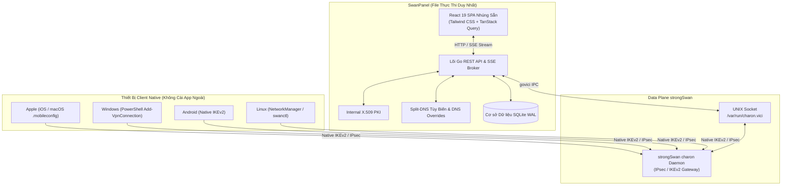

<div align="center">

# SwanPanel

**Bảng điều khiển Web hiện đại cho strongSwan Remote Access VPN với cấu hình 100% native client**

[](https://github.com/thienvu18/swan-panel/releases)
[](https://github.com/thienvu18/swan-panel/actions/workflows/ci.yml)
[](https://thienvu18.github.io/swan-panel/)
[](https://golang.org)
[](https://github.com/strongswan/strongswan)
[](LICENSE)

[Website & Tài liệu](https://thienvu18.github.io/swan-panel/) • [English](README.md) • [Tiếng Việt](README.vi.md) • [Wiki](https://github.com/thienvu18/swan-panel/wiki)

</div>

---

## Tổng quan

**SwanPanel** là bảng điều khiển web mã nguồn mở, gọn nhẹ dưới dạng một file thực thi duy nhất (single-binary) dành cho [strongSwan](https://github.com/strongswan/strongswan) — daemon VPN IPsec/IKEv2 chuẩn mực và phổ biến nhất trong thế giới Linux.

Mặc dù strongSwan mang lại hiệu năng mã hóa phần cứng vượt trội và khả năng tương thích tự nhiên (native) trên mọi hệ điều hành, việc quản trị qua giao diện dòng lệnh (CLI) đòi hỏi quản trị viên phải trực tiếp SSH vào máy chủ, cấu hình các file văn bản phức tạp và quản lý chứng chỉ PKI thủ công. SwanPanel giải quyết vấn đề này bằng cách cung cấp giao diện web trực quan: nạp cấu hình động trực tiếp trên RAM, tự động cấp phát chứng chỉ số và xuất cấu hình client native chỉ với 1 cú click.

---

## Danh sách Tính năng Nổi bật

### 1. Cấu hình Client Native 100% (Không cần cài App ngoài)
* **Hệ sinh thái Apple (macOS & iOS):** Tự động tạo profile `.mobileconfig` đã ký số, nhúng sẵn chứng chỉ client PKCS#12 và CA trust chain để người dùng cài đặt 1-click trực tiếp trong Cài đặt hệ thống (System Settings).
* **Windows 10 & 11:** Tự động tạo script PowerShell idempotent (`Add-VpnConnection`) tích hợp sẵn định tuyến split-tunneling và bộ mã hóa IKEv2 tương thích.
* **Linux:** Tạo tệp kết nối NetworkManager (`.nmconnection`) hoặc mẫu cấu hình chuẩn `swanctl.conf`.
* **Android:** Cung cấp thông số IKEv2/IPsec RSA Certificate và MSCHAPv2 chuẩn native.

### 2. Điều khiển strongSwan Động qua VICI IPC (Zero-SSH)
* **Hot-Reload trên RAM:** Giao tiếp trực tiếp với tiến trình `charon` qua UNIX domain socket chính thức (`/var/run/charon.vici`) bằng giao thức `govici`. Nạp lại cấu hình trên bộ nhớ RAM mà không làm ngắt các kết nối đang chạy.
* **Quản trị Phiên Thời gian Thực:** Ngắt kết nối tức thì (`terminate`), ép xác thực lại định kỳ và theo dõi trạng thái các kết nối trực tiếp từ giao diện web.
* **Cấu hình Tham số Data Plane:** Bật/tắt chuyển vùng mạng (MOBIKE), ép đóng gói UDP NAT-Traversal, điều chỉnh tần suất DPD keepalive, phân mảnh gói tin và kẹp TCP MSS clamping.

### 3. Tự động hóa Internal PKI (X.509)
* **Khởi tạo CA Tự động:** Tự động tạo và quản lý Certificate Authority (CA) gốc, chứng chỉ máy chủ gateway và chứng chỉ riêng cho từng thiết bị/người dùng.
* **Đóng gói PKCS#12 Tự động:** Xuất gói chứng chỉ bảo vệ bằng mật khẩu (.p12) tải về dùng ngay, không cần gõ lệnh OpenSSL hay CFSSL qua terminal.

### 4. Split-DNS Tùy biến Linh hoạt & Ghi đè DNS (DNS Overrides)
* **MagicDNS Tùy biến Đuôi Tên miền:** Tích hợp máy chủ DNS nội bộ hiệu năng cao (`github.com/miekg/dns`). Đuôi tên miền nội bộ hoàn toàn tùy chỉnh theo ý muốn (ví dụ: `.internal`, `.corp`, `.vpn`, `.strongnet`, v.v.), tự động phân giải về IP ảo của từng thiết bị.
* **Tính năng Ghi đè DNS (DNS Overrides):** Cho phép quản trị viên tự do định nghĩa các bản ghi DNS tùy chỉnh (ví dụ: trỏ `gitlab.company.internal` hoặc `api.internal` thẳng tới IP đích chỉ định), có hiệu lực tức thì cho toàn bộ máy client trong mạng VPN.
* **Chuyển tiếp Truy vấn Ngoài (Upstream Forwarding):** Tự động chuyển tiếp các truy vấn internet đến DNS chỉ định của doanh nghiệp hoặc DNS công cộng (1.1.1.1, 8.8.8.8).

### 5. Giám sát & Bảng Điều khiển Trực tiếp (Real-Time Live Dashboard)
* **Server-Sent Events (SSE):** Luồng sự kiện `/api/realtime/stream` đẩy dữ liệu phiên kết nối, lưu lượng băng thông và trạng thái gateway trực tiếp lên màn hình mà không cần chạy vòng lặp polling hay nhấn refresh.
* **Luồng Nhật ký Hệ thống (Live Logs):** Xem và lọc log chi tiết của strongSwan theo từng người dùng, thiết bị và cấp độ nghiêm trọng.

### 6. Phân quyền Truy cập Zero-Trust & Thư mục Danh tính
* **Đa nhà cung cấp OIDC SSO & Local Directory:** Đăng nhập qua các IdP chuẩn OIDC (Google, Microsoft Azure AD, Okta, Keycloak) hoặc tài khoản quản trị nội bộ.
* **Luật Truy cập Phân cấp:** Thiết lập nhóm người dùng (DevOps, Sales) và phân bổ quyền truy cập theo dải mạng CIDR (Production VPC, Staging, Internal Subnets).

### 7. Kiến trúc Single-Binary Gọn nhẹ, Không Phụ thuộc
* **Một Tệp Thực thi Duy nhất:** Go backend, cơ sở dữ liệu SQLite thuần Go (chế độ WAL hiệu năng cao), giao diện React 19 SPA nhúng sẵn, PKI và máy chủ DNS được biên dịch thành 1 file nhị phân duy nhất.
* **Không Cần Cài Database Ngoài:** Hoạt động độc lập không phụ thuộc vào PostgreSQL, MySQL, Redis hay cụm container phức tạp.

---

## Tại sao chọn SwanPanel?

### So với strongSwan thuần (Chỉ dùng CLI)

| Tính năng | strongSwan thuần (CLI) | SwanPanel |
| :--- | :--- | :--- |
| **Quản trị Daemon** | Phải SSH vào máy chủ + chỉnh sửa file text thủ công | Giao diện Web trực quan qua socket `/var/run/charon.vici` |
| **Nạp lại Cấu hình** | Khởi động lại daemon có nguy cơ ngắt các tunnel đang chạy | Hot-reload trên RAM (`load-conn`) không downtime |
| **Quản lý Chứng chỉ PKI**| Gõ lệnh OpenSSL / CFSSL thủ công trên terminal | Tự động hóa hoàn toàn CA & tạo bundle PKCS#12 |
| **Cấp phát cho Client** | Viết tài liệu hướng dẫn nhân viên tự cài cert & set route | Xuất 1-click profile (Apple `.mobileconfig`, Windows PowerShell) |
| **Hệ thống DNS Nội bộ** | Phải dựng riêng máy chủ BIND / Unbound phức tạp | Tích hợp sẵn Split-DNS tùy biến đuôi tên miền & ghi đè DNS |
| **Theo dõi Trạng thái** | Gõ `swanctl --list-sas` trong terminal | Live Dashboard thời gian thực (SSE) hiển thị trực quan |

### So với các giải pháp VPN khác (OpenVPN, WireGuard, Tailscale)

* **Không cần cài đặt ứng dụng bên thứ ba (Zero 3rd-Party Client):**
  Các giải pháp như OpenVPN, WireGuard hay Tailscale đều bắt buộc người dùng cuối phải cài đặt, cấp quyền hệ thống và cập nhật liên tục ứng dụng client của họ trên từng máy tính và điện thoại. Ngược lại, strongSwan sử dụng chuẩn **IKEv2/IPsec đã được tích hợp sẵn trong nhân hệ điều hành** của iOS, macOS, Windows 10/11, Android và Linux. Nhân viên chỉ cần tải profile về và kết nối trực tiếp từ Cài đặt hệ thống (System Settings).
* **Đóng gói gọn nhẹ dạng Single-Binary:**
  Toàn bộ hệ thống (Go backend, React 19 SPA nhúng sẵn, SQLite chế độ WAL, PKI nội bộ và DNS engine) được biên dịch thành **một file thực thi duy nhất**. Không cần cài đặt máy chủ cơ sở dữ liệu ngoài (PostgreSQL, MySQL, Redis) hay cấu hình Docker Compose phức tạp.
* **Tự chủ hoàn toàn (100% Self-Hosted & Sovereign):**
  Không phụ thuộc vào máy chủ điều phối cloud của bên thứ ba như Tailscale hay Cloudflare Zero Trust. Toàn bộ hạ tầng mạng, khóa mật mã và dữ liệu truy cập hoàn toàn thuộc quyền kiểm soát của bạn.

---

## Sơ đồ Kiến trúc



---

## Cài đặt & Khởi chạy Nhanh

### 1. Cài đặt Tự Động 1-Dòng Lệnh (Khuyến nghị cho Production)
Chạy script cài đặt tự động trên bất kỳ máy chủ Linux nào (Ubuntu, Debian, Rocky Linux, AlmaLinux):
```bash
curl -fsSL https://raw.githubusercontent.com/thienvu18/swan-panel/main/install.sh | sudo bash
```

### 2. Biên dịch từ Mã nguồn
```bash
git clone https://github.com/thienvu18/swan-panel.git
cd swan-panel

# Biên dịch frontend React 19 và đóng gói thành file thực thi Go duy nhất
cd ui && npm install && npm run build && cd ..
go build -o swan-panel ./cmd/server

# Khởi chạy SwanPanel
./swan-panel
```
Truy cập bảng điều khiển tại: `http://localhost:8080`.

### 3. Tài khoản Quản trị viên Mặc định
* **Email:** `admin@swanpanel.internal`
* **Mật khẩu:** `admin123456`

*(Vui lòng đổi mật khẩu quản trị viên ngay sau khi triển khai thực tế).*

---

## Triển Khai Production

SwanPanel hỗ trợ hai phương thức triển khai chính trên máy chủ Linux/VPS:
* **Docker & Docker Compose** (Được đóng gói sẵn kèm strongSwan, Split-DNS, iptables/nftables)
* **Native Systemd Daemon** (Chạy trực tiếp binary đơn tĩnh trên hệ điều hành)

Tài liệu chi tiết về cấu hình tường lửa và biến môi trường có tại [deploy/README.md](deploy/README.md).

### Lựa Chọn 1: Triển Khai Bằng Docker Compose (Khuyến nghị)

1. Clone kho lưu trữ mã nguồn:
   ```bash
   git clone https://github.com/thienvu18/swan-panel.git
   cd swan-panel
   ```

2. Khởi động hệ thống với Docker Compose:
   ```bash
   docker compose up -d
   ```

3. Kiểm tra nhật ký và trạng thái container:
   ```bash
   docker compose ps
   docker compose logs -f
   ```

*(Container đã cấu hình sẵn quyền `cap_add: [NET_ADMIN, NET_RAW]`, gắn volume `/var/run/charon.vici` và phơi các cổng UDP 500, 4500, DNS 53, HTTP 8080)*.

### Lựa Chọn 2: Triển Khai Native Service (systemd)

Dành cho quản trị viên muốn chạy trực tiếp trên hệ điều hành Linux:

1. Tải và cài đặt binary vào `/usr/local/bin/swan-panel`:
   ```bash
   sudo install -m 755 swan-panel /usr/local/bin/swan-panel
   ```

2. Thiết lập tệp cấu hình môi trường và dịch vụ systemd:
   ```bash
   sudo mkdir -p /etc/swan-panel /var/lib/swan-panel
   sudo cp deploy/swan-panel.env.example /etc/swan-panel/swan-panel.env
   sudo chmod 600 /etc/swan-panel/swan-panel.env
   sudo cp deploy/systemd/swan-panel.service /etc/systemd/system/swan-panel.service
   ```

3. Nạp lại systemd và kích hoạt dịch vụ:
   ```bash
   sudo systemctl daemon-reload
   sudo systemctl enable --now strongswan-starter || sudo systemctl enable --now strongswan
   sudo systemctl enable --now swan-panel
   ```

4. Theo dõi nhật ký hoạt động:
   ```bash
   sudo journalctl -u swan-panel -f
   ```

---

## Bảng Biến Môi trường (Cấu hình)

Bạn có thể tùy biến cấu hình qua biến môi trường hoặc tệp `.env`:

| Biến môi trường | Giá trị mặc định | Giải thích chi tiết |
| :--- | :--- | :--- |
| `PORT` | `8080` | Cổng HTTP phục vụ giao diện Web và REST API |
| `DB_PATH` | `swanpanel.db` | Đường dẫn file cơ sở dữ liệu SQLite |
| `JWT_SECRET` | *(Ngẫu nhiên)* | Khóa bí mật ký token JWT (**Phải đổi khi lên production**) |
| `LOG_LEVEL` | `info` | Mức độ chi tiết log: `debug`, `info`, `warn`, `error` |
| `VICI_SOCKET` | `/var/run/charon.vici` | Đường dẫn socket UNIX kết nối tới strongSwan |
| `ENABLE_DNS` | `true` | Bật hoặc tắt máy chủ Split-DNS nội bộ |
| `DNS_PORT` | `5353` | Cổng máy chủ DNS (`53` khi chạy với quyền root/production) |
| `APP_ENV` | `development` | Môi trường ứng dụng (`development` hoặc `production`) |

---

## Quy chuẩn Kỹ thuật & Thực hành Bảo mật

SwanPanel tuân thủ nghiêm ngặt các quy chuẩn kỹ thuật phần mềm doanh nghiệp:
* **Không lỗi SQL Injection:** 100% truy vấn dữ liệu sử dụng tham số hóa (parameterized queries) qua GORM; cấm tuyệt đối ghép chuỗi SQL thô.
* **Bảo mật OWASP:** Cấu hình sẵn các HTTP security headers (CSP, HSTS, `X-Frame-Options: DENY`, `X-Content-Type-Options: nosniff`).
* **Chống tấn công thời gian (Timing-Safe):** So sánh token, API key và chuỗi mật mã bằng thời gian hằng số (`crypto/subtle.ConstantTimeCompare`).
* **Giới hạn tần suất (Rate Limiting):** Tích hợp token-bucket rate limiter trên các endpoint xác thực công khai.

---

## Tinh thần Dự án (Project Philosophy)

SwanPanel được xây dựng dựa trên 3 nguyên tắc cốt lõi:
1. **Tận dụng Tính năng Native của Hệ điều hành:** Mọi hệ điều hành hiện đại đều đã tích hợp sẵn ngăn xếp IKEv2/IPsec ổn định và tối ưu phần cứng. Người dùng không nhất thiết phải cài đặt thêm ứng dụng chạy ngầm của bên thứ ba chỉ để kết nối mạng riêng.
2. **Kiến trúc Tối giản:** Không cồng kềnh, không đòi hỏi cụm máy chủ điều phối phức tạp. Một file nhị phân duy nhất chạy song song cùng strongSwan là đủ cho nhu cầu vận hành thực tế.
3. **Chủ quyền Dữ liệu & Mạng lưới:** Tài khoản, khóa bảo mật, luật phân quyền và lưu lượng mạng hoàn toàn thuộc quyền sở hữu của bạn, không bị ràng buộc bởi chi phí thuê bao SaaS hay sự kiểm soát của nhà cung cấp cloud.

---

## Cộng đồng & Hướng dẫn Đóng góp

SwanPanel là dự án mã nguồn mở vì cộng đồng. Chúng tôi luôn hoan nghênh và trân trọng mọi đóng góp:

### Cách thức Đóng góp:
* **Báo lỗi & Đề xuất tính năng:** Mở Issue trên GitHub kèm mô tả chi tiết, các bước tái hiện hoặc đề xuất luồng nghiệp vụ.
* **Gửi Pull Request:** Kiểm tra các Issue sẵn có, tuân thủ quy chuẩn viết mã trong [AGENTS.md](AGENTS.md) và đảm bảo toàn bộ bài test vượt qua (`go test -v ./...`).
* **Đóng góp Dịch thuật (i18n):**
  1. Sao chép tệp `ui/src/locales/en.json` thành `ui/src/locales/<mã-ngôn-ngữ>.json`.
  2. Dịch các giá trị text sang ngôn ngữ mới (giữ nguyên cấu trúc key JSON).
  3. Khai báo mã ngôn ngữ trong `ui/src/i18n.ts` và tạo Pull Request.

---

## Tác giả & Người đóng góp (Authors & Contributors)

### Tác giả & Quản trị Dự án
* **Thái Thiên Vũ** ([@thienvu18](https://github.com/thienvu18))

<a href="https://github.com/thienvu18">
  
</a>

### Người đóng góp (Contributors)
Cảm ơn tất cả các thành viên cộng đồng đã tham gia đóng góp phát triển SwanPanel!

<a href="https://github.com/thienvu18/swan-panel/graphs/contributors">
  
</a>

---

## Tài liệu Kỹ thuật Chi tiết

* [Đặc tả Kiến trúc & Cơ sở Dữ liệu](ARCHITECTURE.md) — Chi tiết schema quan hệ GORM, REST API và luồng VICI.
* [Hệ thống Thiết kế UI/UX](DESIGN.md) — Chuẩn Google Labs `design.md`, bảng token màu và quy tắc thiết kế.
* [Quy chuẩn Kỹ thuật cho AI Agent](AGENTS.md) — Quy ước lập trình, nguyên tắc bảo mật và lệnh kiểm thử.

---

## Giấy phép Mã nguồn (License)

SwanPanel được phát hành chính thức theo giấy phép **GNU Affero General Public License v3.0 (AGPL-3.0)**.

* **Sử dụng Thương mại:** Miễn phí sử dụng hoàn toàn trong nội bộ doanh nghiệp để quản lý hạ tầng VPN riêng.
* **Quyền Kế thừa (Copyleft):** Mọi phiên bản chỉnh sửa khi phục vụ người dùng qua mạng máy tính đều phải công khai toàn bộ mã nguồn dưới cùng giấy phép AGPL-3.0.
* **Điều khoản Chống Trục lợi SaaS:** Các bên thứ ba và nhà cung cấp đám mây không được phép đóng gói SwanPanel thành dịch vụ SaaS thương mại bán cho khách hàng mà không mở mã nguồn toàn bộ hệ thống quản trị liên quan theo giấy phép AGPL-3.0, hoặc không có sự chấp thuận qua giấy phép thương mại riêng biệt từ tác giả.
