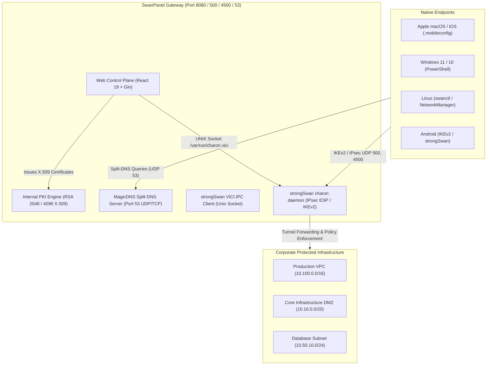

# SwanPanel — Administrator User Guide (Hướng Dẫn Quản Trị Viên)

> **Document Version:** 3.0.0  
> **Target Audience:** Network Engineers, DevOps / SRE Administrators, Security Operations Center (SOC)  
> **Platform Version:** SwanPanel v1.0 Enterprise  
> **Security Baseline:** NIST SP 800-207 Zero-Trust Architecture, FIPS 140-3 Cryptography, RFC 7296 (IKEv2), RFC 4555 (MOBIKE)

---

## 1. ARCHITECTURAL OVERVIEW & ZERO-TRUST MISSION

**SwanPanel** is a single-binary, zero-trust web control plane engineered specifically for high-throughput **strongSwan** Remote Access VPN gateways.

### 1.1. Core Architectural Pillars
* **Single-Binary Delivery:** The control plane encapsulates the Go backend daemon, embedded SQLite database (`gorm`), embedded React 19 SPA (`embed.FS`), internal X.509 PKI certificate authority, and an embedded UDP/TCP DNS server (`miekg/dns`) into a single self-contained executable.
* **Zero-SSH Operations:** Administrators manage the entire gateway lifecycle dynamically. Connection configurations, IP pools, cryptographic proposals, and access rules are loaded directly into strongSwan daemon RAM via the official UNIX socket protocol (`/var/run/charon.vici`) without opening SSH terminals or triggering service restarts.
* **100% Native Client Support:** SwanPanel does not require end users to install third-party, closed-source VPN client applications. It natively generates standard Apple `.mobileconfig` profiles, Windows PowerShell `Add-VpnConnection` scripts, and Linux `swanctl` / NetworkManager configurations.
* **Microsegmentation by Default:** Traffic between connected nodes and enterprise subnets is subject to strict Least Privilege evaluation. All traffic outside explicitly defined `ALLOW` policies is rejected.



---

## 2. GETTING STARTED & SYSTEM INITIALIZATION

### 2.1. Accessing the Control Plane
Navigate your browser to the gateway address: `https://<gateway-fqdn>:8080` (or `http://localhost:8080` in local testing).


### 2.2. Root Administrator Credentials
Upon first initialization, SwanPanel provisions the default system administrator:
* **Default Email:** `admin@swanpanel.internal`
* **Default Password:** `admin123456`
* **1-Click Auto-Fill:** On developer/testing environments, click the blue **"Root Administrator"** badge at the bottom of the card to automatically fill credentials.

> [!IMPORTANT]
> Immediately upon initial login, navigate to [Users Page](file:///Users/thienvu/Documents/Projects/Mines/swan-panel/ui/src/pages/UsersPage.tsx) to update the root administrator password or link an enterprise OIDC Identity Provider.

### 2.3. Language & Theme Customization
* **Internationalization (i18n):** Toggle between **English (EN)** and **Tiếng Việt (VI)** instantly using the globe switcher in the sidebar header.
* **Theme Switching:** Toggle between **Dark Mode** (zinc-950 background `#0b0f17`) and **Light Mode** (slate-50 background `#f8fafc`) via the moon/sun icon.


---

## 3. REAL-TIME OPERATIONS DASHBOARD

The **Dashboard** serves as the mission-critical cockpit for network operations and security analysts.


### 3.1. Telemetry Cards
1. **Active Sessions:** Number of concurrent established IPsec security associations (SAs).
2. **Total Devices:** Total enrolled endpoints with active X.509 certificates.
3. **Total Users:** Registered directory users across local database and OIDC federations.
4. **Gateway Status:** Live status indicator receiving heartbeats over Server-Sent Events (`/api/realtime/stream`).

### 3.2. Active Tunnels Table & Instant Actions
The table displays real-time parameters streamed directly from `charon.vici`:
* **Device Hostname:** Identified endpoint name verified against client certificate Common Name (`CN`).
* **Virtual IP:** Internal leased private IP address with a 1-click **CopyButton**.
* **Remote WAN IP:** Public IP address and NAT traversal UDP port (`172.18.0.3[4500]`).
* **Cipher Suite:** Active cryptographic parameters negotiated in RAM (e.g. `AES_GCM_16-256 / PRF_HMAC_SHA2_384 / ECP_384`).
* **Instant Disconnect (Kill-Switch):** Administrators can immediately terminate any suspicious tunnel by clicking the red trash button, sending a VICI `terminate` command without disturbing other tunnels.

---

## 4. IP SUBNETS & SUBNET CAPACITY METER

SwanPanel organizes your IP address space into dedicated **Resource Groups (Subnets)**.


### 4.1. Visual Subnet Capacity Meter
To prevent IP pool exhaustion, SwanPanel features an automatic, visual capacity meter:
* **Emerald Progress Bar (< 70%):** Healthy allocation pool with ample headroom.
* **Amber Progress Bar (70% - 90%):** Elevated usage; plan expansion or reclaim inactive nodes.
* **Rose Progress Bar (> 90%):** Critical threshold; immediate CIDR block expansion recommended.

### 4.2. Creating a Subnet
1. Navigate to **Resources** > click **Resource Groups** subnav tab.
2. Click **+ Add Subnet** in the top action toolbar.
3. Fill in the required parameters:
   * **Subnet Name:** Descriptive identifier (e.g. `SecOps & Threat Intel Enclave`).
   * **CIDR Block:** Standard IPv4 CIDR notation (e.g. `10.150.0.0/24`). The backend validates syntax and rejects overlapping pools.
   * **Description:** Purpose and access classification of the network segment.
4. Click **Create Subnet**. The subnet pool is immediately active in SQLite and strongSwan daemon routing tables.


---

## 5. DEVICE PROVISIONING & NATIVE CONFIGURATION PROFILES

SwanPanel treats devices as first-class cryptographic identities.


### 5.1. Provisioning a Device
1. Under **Resources** > **Devices**, click **+ Add Device**.
2. Complete the enrollment form:
   * **Hostname:** Unique node hostname (e.g. `secops-jumpbox-01`).
   * **Ownership Type:** Choose between **Company Resource** (servers, gateways, bastions) or **User Device** (employee laptops, mobile devices).
   * **Subnet:** Select the destination Resource Group from the dropdown.
   * **IP Allocation:**
     * **Dynamic:** Leased automatically on connect via RADIUS/IKEv2 configuration attributes.
     * **Static:** Reserve a fixed VIP within the assigned subnet (e.g. `10.150.0.10`).
   * **Platform:** Select destination OS (`macOS`, `Windows`, `Linux`, `iOS`, `Android`).
3. Click **Create Device**. SwanPanel's internal PKI generates a 2048-bit RSA key pair, signs the X.509 client certificate, computes its SHA-256 fingerprint, and stores the record securely.


### 5.2. Faceted Filter Chips & Instant Search
* **Faceted OS Filter:** Filter by `macOS`, `Windows`, `Linux`, `iOS`, `Android`, or view all nodes with real-time count badges.
* **Ownership Filter:** Filter between `Company Resource` and `User Device`.
* **Search-as-you-type:** Instantly filter devices by hostname, assigned virtual IP, or owner email.
* **1-Click Copy:** Click the copy icon next to any hostname or virtual IP to copy it cleanly to your clipboard.

### 5.3. Certificate Revocation (Self-Revoke)
If an endpoint is lost, stolen, or decommissioned:
1. Locate the device row in the table.
2. Click the red **ShieldAlert** icon in the actions column.
3. Confirm the prompt: *"Revoke security certificate for <hostname>?"*.
4. SwanPanel sets `is_revoked = true`, adds the serial to the revocation index, and immediately terminates any active tunnels associated with that certificate.

---

## 6. ZERO-TRUST ACCESS RULES & MICROSEGMENTATION

SwanPanel implements a **Default-Deny** microsegmentation engine.


### 6.1. Policy Evaluation Hierarchy
1. **Explicit DENY:** Any matching `DENY` policy immediately drops the packet and logs a security event.
2. **Explicit ALLOW:** Packets matching an active `ALLOW` policy are permitted to transit the tunnel.
3. **Implicit Drop:** Packets matching no rules are rejected at the kernel firewall boundary.

### 6.2. Creating an Access Rule
1. Navigate to **Access Rules** in the sidebar.
2. Click **+ Add Rule**.
3. Specify:
   * **Subject Type:** Choose `user_group` or `user`.
   * **Subject Name:** Select or enter the user group (e.g. `Site Reliability Engineers`).
   * **Policy Action:** Toggle between `ALLOW` (Emerald) or `DENY` (Rose).
   * **Target Type:** Choose `resource_group` or specific `cidr_ip`.
   * **Target Value:** Enter the destination subnet or CIDR (e.g. `10.150.0.0/24`).
4. Click **Create Rule**. Changes take effect immediately across all connected client sessions.


---

## 7. SPLIT-TUNNEL DNS ENGINE & MAGICDNS

SwanPanel includes an embedded DNS engine designed for split-tunnel remote access.


### 7.1. MagicDNS Automatic Host Resolution
Every device provisioned in SwanPanel automatically receives an internal MagicDNS entry:
```text
<hostname>.internal  ->  <virtual_ip>
```
When a connected client queries `node-24116.internal`, the embedded DNS engine intercepts the request and resolves it to `10.0.1.12` in sub-millisecond response time.

### 7.2. Custom DNS Overrides
Administrators can define custom corporate DNS overrides for internal services:
1. Click **+ Add Override** on the DNS Engine page.
2. Configure:
   * **Hostname (FQDN):** Full domain (e.g. `gitlab.internal.acme.net` or `api.internal`).
   * **Record Type:** Choose `A`, `AAAA`, `CNAME`, or `TXT`.
   * **Target IP / Host:** Destination IP address (e.g. `10.100.1.10`).
3. Click **Add Override**.


### 7.3. Split-DNS Forwarding
Queries outside configured internal zones (e.g. `github.com`, `google.com`) are forwarded transparently to configured upstream resolvers (`1.1.1.1, 8.8.8.8`).

---

## 8. ENTERPRISE IDENTITY & SINGLE SIGN-ON (OIDC)

Federate user authentication with enterprise Identity Providers (IdPs) via standard OpenID Connect.


### 8.1. Supported Providers
* **Okta Workforce Identity Cloud**
* **Microsoft Entra ID (Azure AD)**
* **Google Workspace**
* **Keycloak / Authentik / Generic OIDC**

### 8.2. Configuring an OIDC Provider
1. Navigate to **OIDC Providers** > click **+ Add Provider**.
2. Configure:
   * **Provider Name:** Identifier (e.g. `Corporate Okta SSO`).
   * **Provider Type:** Select provider profile.
   * **Issuer URL:** Identity Provider Discovery endpoint (e.g. `https://acme.okta.com/oauth2/default`).
   * **Client ID:** Application ID from your IdP console.
   * **Client Secret:** Application Secret key. Use the eye icon toggle (`Eye`/`EyeOff`) to inspect or mask the secret.
   * **Redirect URI:** Copy the auto-generated callback URI (`https://<gateway>:8080/api/auth/oidc/callback`) using the 1-click **CopyButton** and paste it into your IdP's allowed redirect list.
3. Click **Save Provider**.


---

## 9. USER DIRECTORY & ROLE-BASED ACCESS CONTROL (RBAC)

Manage corporate staff, contractor accounts, and role privileges.


### 9.1. User Directory & Approvals
* **Local Accounts:** Create direct accounts with email, password (hashed with `bcrypt`), and name.
* **Role Management:** Toggle between standard user and Administrator (`is_admin: true`) with 1 click.
* **Approval Queue:** External OIDC registrations can be staged as `PENDING` until approved by an administrator.


### 9.2. User Groups
Group users logically (e.g. `DevOps Engineers`, `External Auditors`, `Finance Team`) to apply Access Rules in bulk.


---

## 10. STRONGSWAN ENGINE CONFIGURATION

Fine-tune kernel IPsec parameters and strongSwan daemon runtime settings without ever editing text config files.


### 10.1. Cryptographic Proposal Presets
* **Modern (High Security):**
  * IKE: `aes256gcm16-prfsha384-ecp384`
  * ESP: `aes256gcm16,chacha20poly1305`
* **Balanced (Recommended):**
  * IKE: `aes256gcm16-prfsha384-ecp384,aes256-sha256-modp2048`
  * ESP: `aes256gcm16,aes128gcm16,chacha20poly1305`
* **Custom:** Freeform string for specialized hardware accelerators or compliance standards.

### 10.2. Network Roaming & Traversal
* **MOBIKE (RFC 4555):** Enabled by default. Clients switching networks (e.g. office Wi-Fi to cellular LTE) seamlessly update their tunnel IP address without dropping active TCP connections or re-authenticating.
* **Force UDP Encapsulation (NAT-T):** Enforces UDP port 4500 encapsulation for traversing strict carrier-grade NATs.
* **MTU MSS Clamping:** Automatically clamped to `1360` bytes to eliminate IP fragmentation across lower MTU carrier networks.

### 10.3. Dynamic Zero-Downtime Reload
When changes are made, click the top-right contextual button **Save Changes**. SwanPanel compiles the parameters into a native VICI dictionary and reloads connections directly in strongSwan daemon memory with **0 seconds downtime**.

---

## 11. REAL-TIME OBSERVABILITY & SYSTEM LOGS TERMINAL

Monitor low-level daemon events and debug client connectivity in real time.


### 11.1. Live charon Socket Stream
The log terminal receives structured log events directly from the `/var/run/charon.vici` UNIX socket:
* **Timestamp & Log Level:** `INFO` (blue), `WARN` (amber), `ERROR` (rose).
* **Subsystem Tags:** `ike` (IKE_SA negotiation), `chd` (CHILD_SA installation), `enc` (crypto engines), `net` (routing).

### 11.2. Smart Auto-Scroll Control
* **Auto-Scroll Active:** Terminal automatically scrolls to the bottom as new lines arrive.
* **Auto-Scroll Paused:** When an administrator scrolls up to inspect an error line, auto-scroll pauses and displays an animated floating badge: *"Auto-scroll paused (Click to resume)"*.
* **Resume:** Click the floating pill or scroll back to the bottom to resume live trailing.

### 11.3. Faceted Severity Filters
Filter the live stream by clicking the chips: `ALL`, `INFO`, `WARN`, or `ERROR` to eliminate noise during security audits.

---

## 12. ADMINISTRATIVE TROUBLESHOOTING & FAQ

### 12.1. Gateway Health Check
Query the unauthenticated health endpoint:
```bash
curl -i http://localhost:8080/api/health
# Expected: HTTP 200 {"service":"SwanPanel","status":"healthy"}
```

### 12.2. Checking strongSwan Daemon Status via VICI
Verify that the strongSwan daemon is active inside the container or host:
```bash
docker exec swan-panel swanctl --stats
```

### 12.3. Emergency Database Backup
All configuration, certificates, and user records are stored in the single SQLite database:
```bash
# Live backup of SQLite database
sqlite3 /data/swanpanel.db ".backup '/backup/swanpanel-backup-$(date +%F).db'"
```

---

## 13. UI THEME & LANGUAGE MATRIX

SwanPanel provides 100% parity across both languages and color schemes:

| Feature Route | English Light | English Dark | Vietnamese Light | Vietnamese Dark |
| :--- | :---: | :---: | :---: | :---: |
| **Login Screen** | [View](file:///Users/thienvu/.gemini/antigravity/brain/f70050a8-6911-477c-93ec-8ca212f94929/user-guide/en/light/01_login_page.png) | [View](file:///Users/thienvu/.gemini/antigravity/brain/f70050a8-6911-477c-93ec-8ca212f94929/user-guide/en/dark/01_login_page.png) | [View](file:///Users/thienvu/.gemini/antigravity/brain/f70050a8-6911-477c-93ec-8ca212f94929/user-guide/vi/light/01_login_page.png) | [View](file:///Users/thienvu/.gemini/antigravity/brain/f70050a8-6911-477c-93ec-8ca212f94929/user-guide/vi/dark/01_login_page.png) |
| **Dashboard** | [View](file:///Users/thienvu/.gemini/antigravity/brain/f70050a8-6911-477c-93ec-8ca212f94929/user-guide/en/light/02_dashboard.png) | [View](file:///Users/thienvu/.gemini/antigravity/brain/f70050a8-6911-477c-93ec-8ca212f94929/user-guide/en/dark/02_dashboard.png) | [View](file:///Users/thienvu/.gemini/antigravity/brain/f70050a8-6911-477c-93ec-8ca212f94929/user-guide/vi/light/02_dashboard.png) | [View](file:///Users/thienvu/.gemini/antigravity/brain/f70050a8-6911-477c-93ec-8ca212f94929/user-guide/vi/dark/02_dashboard.png) |
| **Subnets** | [View](file:///Users/thienvu/.gemini/antigravity/brain/f70050a8-6911-477c-93ec-8ca212f94929/user-guide/en/light/03_resources_subnets.png) | [View](file:///Users/thienvu/.gemini/antigravity/brain/f70050a8-6911-477c-93ec-8ca212f94929/user-guide/en/dark/03_resources_subnets.png) | [View](file:///Users/thienvu/.gemini/antigravity/brain/f70050a8-6911-477c-93ec-8ca212f94929/user-guide/vi/light/03_resources_subnets.png) | [View](file:///Users/thienvu/.gemini/antigravity/brain/f70050a8-6911-477c-93ec-8ca212f94929/user-guide/vi/dark/03_resources_subnets.png) |
| **Devices** | [View](file:///Users/thienvu/.gemini/antigravity/brain/f70050a8-6911-477c-93ec-8ca212f94929/user-guide/en/light/05_resources_devices.png) | [View](file:///Users/thienvu/.gemini/antigravity/brain/f70050a8-6911-477c-93ec-8ca212f94929/user-guide/en/dark/05_resources_devices.png) | [View](file:///Users/thienvu/.gemini/antigravity/brain/f70050a8-6911-477c-93ec-8ca212f94929/user-guide/vi/light/05_resources_devices.png) | [View](file:///Users/thienvu/.gemini/antigravity/brain/f70050a8-6911-477c-93ec-8ca212f94929/user-guide/vi/dark/05_resources_devices.png) |
| **Access Rules** | [View](file:///Users/thienvu/.gemini/antigravity/brain/f70050a8-6911-477c-93ec-8ca212f94929/user-guide/en/light/11_access_rules.png) | [View](file:///Users/thienvu/.gemini/antigravity/brain/f70050a8-6911-477c-93ec-8ca212f94929/user-guide/en/dark/11_access_rules.png) | [View](file:///Users/thienvu/.gemini/antigravity/brain/f70050a8-6911-477c-93ec-8ca212f94929/user-guide/vi/light/11_access_rules.png) | [View](file:///Users/thienvu/.gemini/antigravity/brain/f70050a8-6911-477c-93ec-8ca212f94929/user-guide/vi/dark/11_access_rules.png) |
| **DNS Engine** | [View](file:///Users/thienvu/.gemini/antigravity/brain/f70050a8-6911-477c-93ec-8ca212f94929/user-guide/en/light/13_dns_engine.png) | [View](file:///Users/thienvu/.gemini/antigravity/brain/f70050a8-6911-477c-93ec-8ca212f94929/user-guide/en/dark/13_dns_engine.png) | [View](file:///Users/thienvu/.gemini/antigravity/brain/f70050a8-6911-477c-93ec-8ca212f94929/user-guide/vi/light/13_dns_engine.png) | [View](file:///Users/thienvu/.gemini/antigravity/brain/f70050a8-6911-477c-93ec-8ca212f94929/user-guide/vi/dark/13_dns_engine.png) |
| **OIDC Providers** | [View](file:///Users/thienvu/.gemini/antigravity/brain/f70050a8-6911-477c-93ec-8ca212f94929/user-guide/en/light/15_oidc_providers.png) | [View](file:///Users/thienvu/.gemini/antigravity/brain/f70050a8-6911-477c-93ec-8ca212f94929/user-guide/en/dark/15_oidc_providers.png) | [View](file:///Users/thienvu/.gemini/antigravity/brain/f70050a8-6911-477c-93ec-8ca212f94929/user-guide/vi/light/15_oidc_providers.png) | [View](file:///Users/thienvu/.gemini/antigravity/brain/f70050a8-6911-477c-93ec-8ca212f94929/user-guide/vi/dark/15_oidc_providers.png) |
| **Server Settings** | [View](file:///Users/thienvu/.gemini/antigravity/brain/f70050a8-6911-477c-93ec-8ca212f94929/user-guide/en/light/17_server_settings.png) | [View](file:///Users/thienvu/.gemini/antigravity/brain/f70050a8-6911-477c-93ec-8ca212f94929/user-guide/en/dark/17_server_settings.png) | [View](file:///Users/thienvu/.gemini/antigravity/brain/f70050a8-6911-477c-93ec-8ca212f94929/user-guide/vi/light/17_server_settings.png) | [View](file:///Users/thienvu/.gemini/antigravity/brain/f70050a8-6911-477c-93ec-8ca212f94929/user-guide/vi/dark/17_server_settings.png) |
| **System Logs** | [View](file:///Users/thienvu/.gemini/antigravity/brain/f70050a8-6911-477c-93ec-8ca212f94929/user-guide/en/light/18_system_logs.png) | [View](file:///Users/thienvu/.gemini/antigravity/brain/f70050a8-6911-477c-93ec-8ca212f94929/user-guide/en/dark/18_system_logs.png) | [View](file:///Users/thienvu/.gemini/antigravity/brain/f70050a8-6911-477c-93ec-8ca212f94929/user-guide/vi/light/18_system_logs.png) | [View](file:///Users/thienvu/.gemini/antigravity/brain/f70050a8-6911-477c-93ec-8ca212f94929/user-guide/vi/dark/18_system_logs.png) |

---

## 14. ADVANCED ADMINISTRATIVE WORKFLOWS: INTERACTIVE ACTIONS AUDIT

To verify and document operations as an actual network security administrator, SwanPanel underwent extensive interactive browser execution covering search-as-you-type, faceted filter chips, instant kill-switches, and end-to-end CRUD resource lifecycles.

```text
[ Interactive Evidence Directory ]
└── /Users/thienvu/.gemini/antigravity/brain/f70050a8-6911-477c-93ec-8ca212f94929/user-actions-evidence/
    ├── 01_dashboard_live_tunnel_active.png          (Active Session with VIP & Cipher)
    ├── 02_dashboard_after_terminate_empty_state.png  (Kill-Switch Instant Disconnect)
    ├── 03_search_devices_typing_keyword.png         (Real-Time Device Search)
    ├── 04_search_devices_empty_state_with_reset.png (Non-matching Search & Reset)
    ├── 05_filter_devices_by_os_linux.png            (Faceted Filter by OS: Linux)
    ├── 06_filter_devices_by_type_company.png        (Faceted Filter by Type: Company)
    ├── 07_search_subnets_by_cidr.png                (Subnet Search by CIDR: 10.100)
    ├── 08_subnet_created_before_delete.png          (Subnet Enclave Created)
    ├── 09_subnet_deleted_success.png                (Subnet Deleted via Trash Button)
    ├── 10_search_access_rules_by_name.png           (Access Rules Search: database)
    ├── 11_filter_access_rules_allow.png             (Faceted Filter: ALLOW Policies)
    ├── 12_filter_access_rules_deny.png              (Faceted Filter: DENY Policies)
    ├── 13_access_rule_created_before_delete.png     (Access Rule Policy Created)
    ├── 14_delete_access_rule_action.png             (Access Rule Policy Deleted)
    ├── 15_search_dns_by_fqdn.png                    (DNS FQDN Search: vault)
    ├── 16_filter_dns_by_type_a.png                  (Faceted Filter: Record Type A)
    ├── 17_filter_dns_by_type_cname.png              (Faceted Filter: Record Type CNAME)
    ├── 18_dns_override_created_before_delete.png    (DNS Override Created)
    ├── 19_delete_dns_override_action.png            (DNS Override Deleted)
    ├── 20_search_oidc_by_name.png                   (OIDC IdP Search: Microsoft)
    ├── 21_oidc_provider_created_before_delete.png   (OIDC IdP Created)
    ├── 22_delete_oidc_provider_action.png           (OIDC IdP Deleted)
    ├── 23_search_users_by_name.png                  (User Search by Name: Elena)
    ├── 24_users_tab_user_groups.png                 (Switch to User Groups Subtab)
    ├── 25_group_created_before_delete.png           (User Group Created)
    ├── 27_user_created_success.png                  (Directory User Created)
    ├── 29_system_logs_severity_info.png             (Severity Filter: INFO)
    ├── 30_system_logs_severity_warn.png             (Severity Filter: WARN)
    ├── 31_system_logs_severity_error.png            (Severity Filter: ERROR)
    ├── 32_system_logs_scope_filter.png              (Scope Filter Dropdown)
    └── 33_system_logs_stream_paused.png             (Terminal Stream Paused)
```

### 14.1. Dashboard Kill-Switch Disconnect & Session Termination

SwanPanel provides zero-delay tunnel kill-switch capabilities via `/api/sessions/terminate`.


1. **Active Tunnel Row:** Displays verified endpoint identity (`CN`), internal VIP with 1-click **CopyButton**, remote WAN address (`172.18.0.3[4500]`), cryptographic proposal (`AES_CBC-256`), and red trash action button.
2. **Instant Kill-Switch:** Clicking the disconnect button dispatches a VICI IPC terminate command to strongSwan daemon RAM, immediately purging the security association without restarting charon.
3. **EmptyState Transition:** The session table instantaneously refreshes via SSE to display the `<EmptyState>` component with the Activity icon.


### 14.2. Enrolled Devices: Real-Time Hostname Search & Faceted Filtering

Manage thousands of enterprise endpoints through combined search and multi-dimensional filters.


* **Search-as-you-type:** Typing `swan-client` filters the device table instantly without full page reloads.
* **Non-Matching Search Recovery:** When a query yields 0 results, an interactive EmptyState appears with a primary **Clear Filters** button that resets all search parameters with 1 click.


* **Faceted OS Filter:** Clicking the `LINUX` chip filters the roster to Linux endpoints with real-time node count badges.
* **Ownership Filter:** Clicking `Company` isolates corporate bastions and managed gateways from BYOD user devices.


### 14.3. Resource Groups & Subnets: CIDR Filtering & Subnet Deletion

Audit corporate IP spaces with real-time CIDR search and dynamic lifecycle operations.


* **CIDR Prefix Search:** Typing `10.100` isolates the Production VPC subnet and its capacity meter.
* **Subnet Lifecycle (Create & Delete):** Create temporary subnets (e.g. `Temporary Staging Enclave`) and immediately prune them via the red trash button. The capacity bar and routing tables update instantaneously.


### 14.4. Zero-Trust Access Rules: Policy Search, ALLOW/DENY Filtering & Deletion

SwanPanel's Zero-Trust engine supports rapid policy verification.


* **Policy Search:** Search by target subnet or rule classification (`database`).
* **Faceted Action Chips:** Switch between `ALLOW` (green shield) and `DENY` (red shield) rules with real-time policy counters.
* **Policy Deletion:** Click the trash action icon on any rule row to immediately revoke network transit permission.


### 14.5. Split-DNS Engine: FQDN Search, Record Type Filtering & Deletion

Manage custom internal domain overrides and authoritative zone mappings.


* **FQDN Search:** Real-time lookup of internal hostnames (e.g. `vault`).
* **Record Type Filtering:** Toggle between `A` (IPv4 address) and `CNAME` (canonical alias) records with real-time record count badges.
* **Override Lifecycle:** Add dynamic internal overrides (e.g. `temp-api.internal -> 10.222.1.99`) and delete them with 1 click.


### 14.6. Enterprise OIDC SSO: Provider Search & Lifecycle Management

Manage external identity provider federations with real-time provider filtering and credentials management.


* **IdP Search:** Instantly locate identity providers by name (e.g. `Microsoft`).
* **Provider Lifecycle:** Add staging SSO profiles and delete outdated provider integrations.


### 14.7. Directory & User Groups: User Search & Group Lifecycle

Organize human identities into logical security groups.


* **Directory Search:** Real-time search by user name or email (`Elena`).
* **Subtab Switching:** Instant transition between **Directory & Approvals** and **User Groups**.
* **Group Lifecycle:** Provision and delete custom access groups (e.g. `Temp Security Auditors`).


### 14.8. System Observability: Multi-Tier Severity Filtering & Stream Controls

Eliminate noise and isolate critical security anomalies within the live socket console.

* **Severity Filtering:** Filter logs by `INFO` (blue), `WARN` (amber), or `ERROR` (rose).
* **Target Scope Filter:** Narrow the stream to specific endpoints (`swan-client`) or directory accounts (`Elena Rostova`).
* **Stream Controls:** Use **Pause / Resume** to freeze the live terminal output during forensic analysis.


