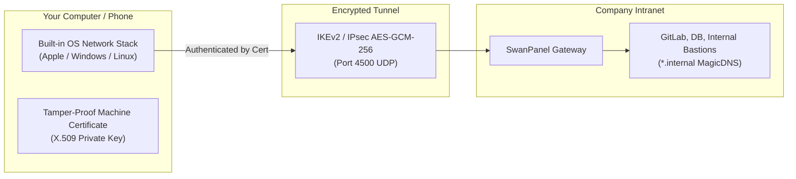

# SwanPanel — End User Connection Guide (Hướng Dẫn Kết Nối Người Dùng)

> **Document Version:** 3.0.0  
> **Target Audience:** All Employees, Remote Contractors, Corporate Device Users  
> **Platform Version:** SwanPanel v1.0 Enterprise  
> **Supported Client Operating Systems:** Apple macOS, Apple iOS / iPadOS, Microsoft Windows 11 / 10, Linux (Ubuntu, Debian, Fedora, Arch, Alpine), Android 12+

---

## 1. INTRODUCTION: ZERO-CLIENT NATIVE VPN

Welcome to **SwanPanel**! Your company utilizes SwanPanel to provide secure, encrypted, zero-trust access to internal company servers, databases, and development environments.

### Why You Do Not Need to Install 3rd-Party VPN Software
Unlike traditional VPN solutions that require proprietary third-party software (such as OpenVPN, Cisco AnyConnect, or proprietary WireGuard clients), SwanPanel leverages the **native IKEv2 / IPsec protocol engine** built directly into your operating system kernel:
* **Zero Battery Drain:** Uses built-in OS crypto accelerators (Apple CryptoKit, Windows IPsec engine, Linux kernel XFRM).
* **Zero Bloatware:** No background updater agents or vendor software running in your tray.
* **Instant Reconnect (MOBIKE):** Switching between home Wi-Fi, office networks, and phone hotspots happens seamlessly without disconnecting your active SSH sessions or downloads.
* **X.509 Cryptographic Security:** Your device is authenticated using a unique, tamper-proof digital certificate. You never have to memorize or type VPN passwords.



---

## 2. APPLE macOS CONNECTION GUIDE

* **Supported Versions:** macOS Sonoma (14.x), Ventura (13.x), Monterey (12.x), Big Sur (11.x)  
* **Configuration Format:** Apple Configuration Profile (`.mobileconfig`)

```text
[ Sample Device Profile: alex-macbook-pro-16.mobileconfig ]
├── Payload 1: SwanPanel Internal Root CA Certificate
├── Payload 2: Client Identity Certificate & Private Key (PKCS#12)
└── Payload 3: Native IKEv2 Network Configuration (Split-DNS: .internal)
```

### Step 1: Download Your Configuration Profile
1. Log in to SwanPanel (or receive the profile from your IT department).
2. Under **Resources** > **Devices**, locate your Mac and click the blue **Download** button.
3. Save `<your-device-name>.mobileconfig` to your Downloads folder.

### Step 2: Install the Profile in System Settings
1. Double-click the downloaded `.mobileconfig` file.
2. A notification will appear: *"Profile Downloaded — Review the profile in System Settings"*.
3. Open **System Settings** (or System Preferences).
4. Navigate to **Privacy & Security** > **Profiles** (or search *"Profiles"* in the search bar).
5. Double-click the **SwanPanel VPN (<hostname>)** profile.
6. Click **Install...** in the bottom-left corner.

### Step 3: Confirm Administrator Permission
1. When prompted, enter your Mac user login password or authenticate with **Touch ID**.
2. Click **Install** to confirm trust for the SwanPanel Internal Root CA.
3. Once installed, the status will show a verified green checkmark.

### Step 4: Connect to the VPN
1. Click the **Control Center** icon (top-right menu bar) and select **VPN** (or look for the VPN slider icon).
2. Click **Connect** next to **SwanPanel VPN (<hostname>)**.
3. Within 1 second, the status changes to **Connected**, and the VPN timer begins.

> [!TIP]
> You can enable *"Show VPN status in menu bar"* in System Settings > Control Center to connect and disconnect with a single click from your top menu bar.

---

## 3. APPLE iOS & iPadOS CONNECTION GUIDE

* **Supported Versions:** iOS / iPadOS 16, 17, 18  
* **Configuration Format:** Apple Configuration Profile (`.mobileconfig`)

### Step 1: Download Profile via Safari
1. On your iPhone or iPad, open **Safari** and log in to the SwanPanel user portal.
2. Tap **Download** on your registered iOS device row.
3. Safari displays a prompt: *"This website is trying to download a configuration profile. Do you want to allow this?"* -> Tap **Allow**.
4. When download completes, tap **Close**.

### Step 2: Install in iOS Settings
1. Open the **Settings** app on your iPhone/iPad.
2. You will see a new item near the top: **Profile Downloaded**. Tap it.
3. In the top-right corner, tap **Install**.
4. Enter your device passcode.
5. Tap **Install** on the Certificate Warning screen, then tap **Install** once more to confirm.
6. Tap **Done**.

### Step 3: Connect
1. Return to the main **Settings** screen.
2. Toggle the **VPN** switch to **ON**.
3. A small **`[VPN]`** icon will appear in your device's Dynamic Island or status bar, confirming your encrypted connection.

---

## 4. MICROSOFT WINDOWS 11 / 10 CONNECTION GUIDE

* **Supported Versions:** Windows 11, Windows 10 (Build 19041+)  
* **Configuration Format:** Automated PowerShell Provisioning Script (`setup-<hostname>.ps1`)

### Step 1: Download the PowerShell Script
1. From the SwanPanel portal, download `setup-<hostname>.ps1` to your computer.

### Step 2: Run PowerShell as Administrator
1. Open the Windows Start Menu, type `powershell`.
2. Right-click **Windows PowerShell** and choose **"Run as administrator"**.


### Step 3: Execute the Setup Script
Navigate to your Downloads folder and run:
```powershell
Set-ExecutionPolicy -Scope Process -ExecutionPolicy Bypass
cd $HOME\Downloads
.\setup-<hostname>.ps1
```

### What the Script Configures Automatically:
1. **Root CA Installation:** Imports `SwanPanel Internal Root CA` into `Cert:\LocalMachine\Root`.
2. **Client Identity:** Imports your machine certificate and private key into `Cert:\LocalMachine\My`.
3. **VPN Adapter Creation:** Runs `Add-VpnConnection` with native `IKEv2` and `MachineCertificate` authentication.
4. **FIPS-Compliant Cryptography:** Configures high-throughput IPsec encryption:
   ```powershell
   Set-VpnConnectionIPsecConfiguration -ConnectionName "SwanPanel - <hostname>" `
       -AuthenticationTransformConstants SHA256128 `
       -CipherTransformConstants AES256 `
       -EncryptionMethod AES256 `
       -IntegrityCheckMethod SHA384 `
       -PfsGroup PFS2048 `
       -DHGroup Group14
   ```

### Step 4: Connect via Windows Quick Settings
1. Press the keyboard shortcut `Win + K` (or click the Wi-Fi / Sound icon in the taskbar tray).
2. Select **SwanPanel - <hostname>**.
3. Click **Connect**. The status will display **Connected** immediately.

---

## 5. LINUX CONNECTION GUIDE (UBUNTU / DEBIAN / FEDORA / ARCH)

* **Supported Distributions:** Ubuntu 22.04 / 24.04 LTS, Debian 12, Fedora 39/40, Arch Linux, Alpine Linux  
* **Configuration Format:** Automated Shell Installer (`setup-<hostname>.sh`) or `swanctl.conf`

### Method A: 1-Click Automated Shell Script (Recommended)
1. Download `setup-<hostname>.sh` from SwanPanel.
2. Make it executable and run with `sudo`:
```bash
chmod +x setup-<hostname>.sh
sudo ./setup-<hostname>.sh
```
3. The script automatically:
   * Detects your package manager (`apt`, `dnf`, `pacman`, or `apk`) and installs strongSwan if missing.
   * Installs the Root CA to `/etc/swanctl/x509ca/ca.crt`.
   * Installs your device certificate to `/etc/swanctl/x509/client.crt`.
   * Configures `/etc/swanctl/conf.d/swanpanel.conf`.
   * Loads configurations via `swanctl --load-all` and initiates the tunnel.

### Method B: Manual Inspection & Control via `swanctl`
To manually manage your VPN tunnel at any time:
```bash
# 1. Initiate connection
sudo swanctl --initiate --ike swanpanel-ikev2

# 2. Check tunnel status & active Virtual IP
sudo swanctl --list-sas

# Expected Output:
# swanpanel-ikev2: #1, ESTABLISHED, IKEv2
#   local  'david-iphone-16-pro' @ 172.18.0.3[4500]
#   remote 'swan-panel' @ 172.18.0.2[4500]
#   AES_GCM_16-256/PRF_HMAC_SHA2_384/ECP_384
#   net: #1, reqid 1, INSTALLED, TUNNEL-in-UDP, ESP:AES_GCM_16-256
#     installed 12s ago, bytes: 420 in, 580 out

# 3. Terminate connection
sudo swanctl --terminate --ike swanpanel-ikev2
```

---

## 6. ANDROID CONNECTION GUIDE

* **Supported Versions:** Android 12, 13, 14, 15  
* **Client App:** Official strongSwan VPN Client (Free & Open Source, available on Google Play)

### Step 1: Install strongSwan VPN Client
1. Open **Google Play Store** on your Android device.
2. Search for **strongSwan VPN Client** (by strongSwan Project) and install.

### Step 2: Import Profile
1. On your Android phone, download your configuration bundle from SwanPanel.
2. Open the strongSwan app.
3. Tap the three dots menu (top-right) > **Import VPN profile**.
4. Select the downloaded file and confirm certificate import.

### Step 3: Connect
1. Tap the imported **SwanPanel** profile.
2. Tap **Connect**.
3. A key icon will appear in the notification drawer when connected.

---

## 7. VERIFYING YOUR CONNECTION & MAGICDNS RESOLUTION

Once connected, verify that your tunnel and internal DNS are functioning properly.

### 7.1. Check Your Leased Virtual IP
* **macOS / Linux:**
  ```bash
  # Check virtual IP interface
  ip addr show | grep -E "10\.(0|50|100|150|180|200)"
  # Or on macOS:
  ifconfig | grep "inet 10\."
  ```
* **Windows (PowerShell):**
  ```powershell
  Get-NetIPAddress -InterfaceAlias "SwanPanel*" | Select-Object IPAddress, InterfaceAlias
  ```

### 7.2. Test MagicDNS Internal Host Resolution
Ping or query an internal corporate service:
```bash
# Resolving MagicDNS internal hostname
nslookup gitlab.internal.acme.net
# Expected response from SwanPanel embedded DNS: 10.100.1.10

# Test internal service reachability
curl -I https://gitlab.internal.acme.net
```

### 7.3. Test Split-Tunneling
* **Internal traffic:** Requests to `*.internal`, `10.0.0.0/8`, or company subnets travel through the encrypted VPN tunnel.
* **Public internet traffic:** Streaming services, personal browsing (e.g. `google.com`, `youtube.com`) go directly through your local home/office ISP with zero speed degradation.

---

## 8. FREQUENTLY ASKED QUESTIONS (FAQ) & TROUBLESHOOTING

### Q1: I am at a hotel or coffee shop and the VPN will not connect.
> [!NOTE]
> Public Wi-Fi networks usually require you to accept terms in a **Captive Portal** browser window before granting internet access.
> 1. Disconnect the VPN temporarily.
> 2. Open your browser and navigate to `http://neverssl.com` to trigger the hotel Wi-Fi login page.
> 3. Complete the login, then reconnect your SwanPanel VPN.

### Q2: Windows displays *"A certificate could not be found that can be used with this Extensible Authentication Protocol"*.
> [!IMPORTANT]
> This indicates the client certificate was imported under the current user (`Cert:\CurrentUser\My`) instead of the machine store (`Cert:\LocalMachine\My`).
> Re-run `setup-<hostname>.ps1` from a PowerShell window opened with **"Run as Administrator"**.

### Q3: macOS displays *"Profile Installation Failed — The certificate for this server is invalid"*.
> [!NOTE]
> Make sure your Mac's system clock is set to automatic time synchronization (`time.apple.com`). If your system clock is skewed into the past or future, the cryptographic validity window of the Root CA certificate may fail verification.

### Q4: My company laptop was lost or stolen. What should I do?
> [!CAUTION]
> Immediately notify your IT Security administrator or Helpdesk. They will execute a **Self-Revoke** on your device record in SwanPanel. This immediately revokes the X.509 certificate and prevents unauthorized access to internal resources.
