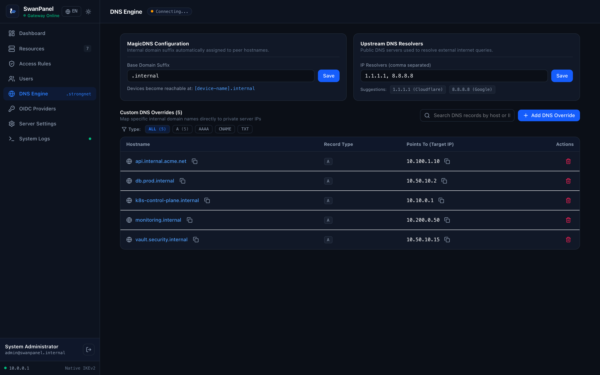

# Split-DNS & MagicDNS Engine

SwanPanel includes an integrated, high-concurrency DNS server built on top of `github.com/miekg/dns`.



---

## 1. MagicDNS Hostname Resolution
- Every device provisioned in SwanPanel receives an internal fully-qualified domain name (FQDN):
  ```text
  <device-hostname>.<magic_dns_suffix>
  ```
- **Default suffix:** `.strongnet` (fully customizable via **DNS Engine** settings to `.internal`, `.corp`, `.vpn`, etc.).
- When a client connects via native IKEv2, strongSwan supplies the SwanPanel internal DNS server IP (`10.60.0.1`) as the primary nameserver.
- Resolving `alice-macbook.strongnet` returns `10.60.0.10` directly from the database without broadcast protocols or external DNS leaks.

---

## 2. Custom DNS Overrides
In corporate or homelab environments, you often need to route specific domain names to internal network services.

### Adding an Override:
1. Navigate to **DNS Engine -> Custom Overrides**.
2. Click **+ Add Override**.
3. Specify:
   - **Hostname:** e.g. `gitlab.company.internal` or `monitoring.prod`
   - **Record Type:** `A` or `CNAME`
   - **Target IP / Host:** e.g. `10.60.0.50`
   - **TTL:** (Default 300 seconds)
4. Click **Create Override**.

The rule activates immediately in the DNS engine without requiring a server reboot.

---

## 3. Recursive Upstream Forwarding
When an incoming query does not match an internal device or custom override:
- SwanPanel queries the configured upstream resolvers (default: `1.1.1.1` and `8.8.8.8`).
- Results are cached in memory according to the record's TTL and returned to the client.
