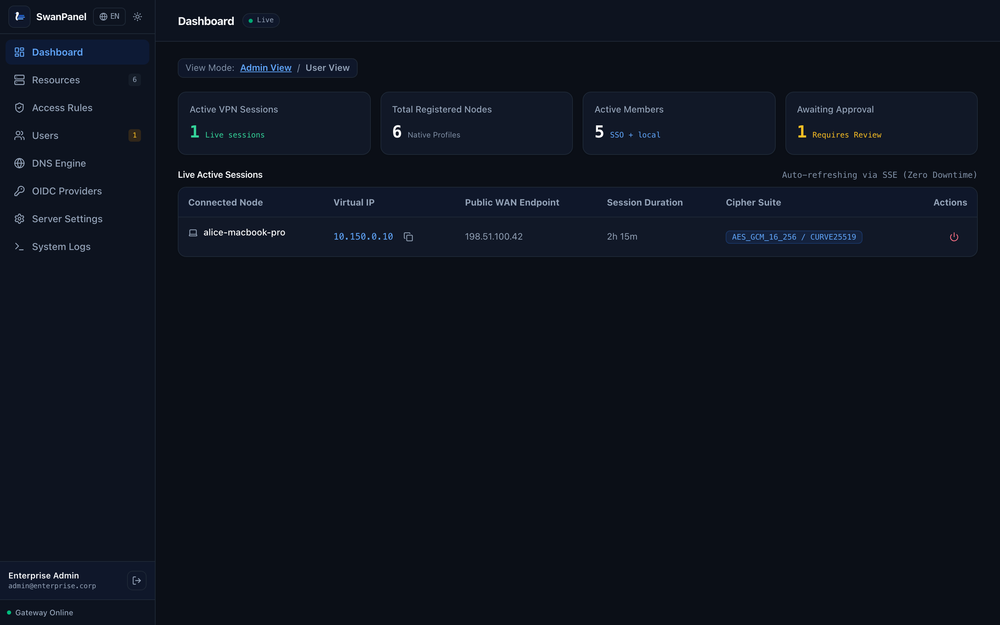

# Welcome to the SwanPanel Wiki

**SwanPanel** is a modern, enterprise-grade, zero-trust web control plane for **strongSwan** Remote Access VPNs.

**Stable v1.0.0:** Built-in VPN on supported devices, clear access decisions, and gateway settings with visible apply status. [Release notes](https://github.com/thienvu18/swan-panel/blob/main/CHANGELOG.md).

---

## Core Wiki Navigation

- [Quickstart & Installation Guide](Quickstart)
- [Administrator Operations Guide](Administrator-Guide)
- [End-User Native Client Guide](End-User-Guide)
- [Architecture & Internals](Architecture)
- [Native Client Provisioning](Client-Provisioning)
- [Split-DNS & MagicDNS Engine](DNS-and-MagicDNS)
- [Zero-Trust Access Policies](Zero-Trust-Policies)
- [REST API Reference](API-Reference)
- [Production Deployment & Hardening](Production-Deployment)
- [Troubleshooting & FAQ](Troubleshooting)

---

## Key Highlights

1. **Native VPN, simpler onboarding:** Use built-in VPN support on compatible Apple, Windows, Linux and Android devices; Android IKEv2/IPsec RSA availability varies by device.
2. **Manage access in one place:** Review effective ALLOW/DENY rules, update gateway settings and check whether saved changes are active without editing VPN files manually.
3. **Single-Binary Delivery:** Go backend, embedded React 19 SPA, SQLite database, internal PKI, and DNS server compile into one self-contained executable.
4. **Data Sovereignty:** Free, open-source AGPL-3.0 software running on your own infrastructure without vendor lock-in or SaaS fees.
