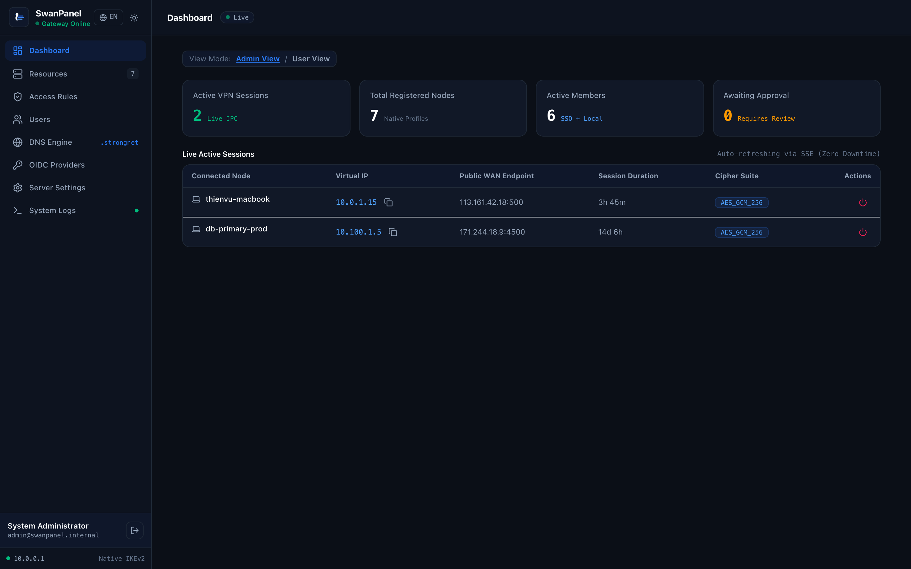

# Welcome to the SwanPanel Wiki

**SwanPanel** is a modern, enterprise-grade, zero-trust web control plane for **strongSwan** Remote Access VPNs.

---

## Core Wiki Navigation

- [Quickstart & Installation Guide](Quickstart)
- [Administrator Operations Guide](Administrator-Guide)
- [End-User Native Client Guide](End-User-Guide)
- [Architecture & Internals](Architecture)
- [Native Client Provisioning](Client-Provisioning)
- [Split-DNS & MagicDNS Engine](DNS-and-MagicDNS)
- [Zero-Trust Access Policies](Zero-Trust-Policies)
- [REST API Reference](API-Reference)
- [Production Deployment & Hardening](Production-Deployment)
- [Troubleshooting & FAQ](Troubleshooting)

---

## Key Highlights

1. **100% Native Client Support:** Native configuration profiles (Apple `.mobileconfig`, Windows PowerShell, Linux NetworkManager, Android IKEv2) without third-party client apps.
2. **Zero-SSH Operations:** Administrate tunnels and reload connections dynamically in RAM via UNIX socket `/var/run/charon.vici` using strongSwan's official VICI protocol.
3. **Single-Binary Delivery:** Go backend, embedded React 19 SPA, SQLite database, internal PKI, and DNS server compile into one self-contained executable.
4. **Data Sovereignty:** Free, open-source AGPL-3.0 software running on your own infrastructure without vendor lock-in or SaaS fees.
